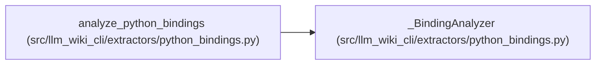

# _BindingAnalyzer

**Location:** `src/llm_wiki_cli/extractors/python_bindings.py:1292`
**Kind:** Class
**Bases:** —
**Module:** [python_bindings](../modules/python_bindings.md)

## Description

_Auto-generated from `_BindingAnalyzer` in `src/llm_wiki_cli/extractors/python_bindings.py`._

## Attributes

*No annotated attributes found.*

## Methods

| Method | Signature | Decorators | Description |
|--------|-----------|------------|-------------|
| `__init__` | `(tree)` | — | — |
| `module` | `()` | `@property` | — |
| `class_mutations` | `()` | `@property` | — |
| `import_mutations` | `()` | `@property` | — |
| `constructor_barriers` | `()` | `@property` | — |
| `constructor_barriers` | `(value)` | `@constructor_barriers.setter` | — |
| `module_namespace_invalidations` | `()` | `@property` | — |
| `module_scope` | `()` | `@property` | — |
| `module_scope` | `(value)` | `@module_scope.setter` | — |
| `function` | `(node, closure: set[str], class_name: str \| None = None)` | — | — |
| `static_method` | `(node) -> bool` | — | — |
| `constructor` | `(node, env)` | — | — |
| `call_binding` | `(node, env, receiver = None)` | — | — |
| `_targets` | `(binding)` | `@staticmethod` | — |
| `_unique_targets` | `(targets)` | `@staticmethod` | — |
| `bind_value` | `(name, value, env, source = None)` | — | — |
| `join_states` | `(states, env, values = ())` | — | Join a whole related graph without erasing aliases or possible owners. |
| `helper_path` | `(node, env)` | — | — |
| `imported_target` | `(node, env)` | — | — |
| `namespace_value` | `(node, env)` | — | — |
| `namespace_mutator` | `(receiver, method)` | `@staticmethod` | Capture every known mapping owner before later argument effects. |
| `mutator_value` | `(node, env)` | — | — |
| `invalidate_target` | `(binding, env, member = '*')` | — | — |
| `invalidate_names` | `(names, env)` | — | — |
| `invalidate_members` | `(node, env, *, recursive = True, mutator = None, arguments = None, store_owner = None)` | — | — |
| `shadow_names` | `(names, env)` | — | Enter a lexical binding without borrowing its outer possible owners. |
| `expression` | `(node, env: dict, closure: set[str], *, capture = True)` | — | — |
| `block` | `(body, env: dict, closure: set[str], *, capture: bool, module: bool = False)` | — | — |

## Relationships

<!-- Auto-generated relationship summary. Do not edit by hand. -->

### Summary

| Module | Methods | Attributes |
|---|---:|---|
| [python_bindings](../modules/python_bindings.md) | 28 | — |

### References

| Reference | Kind | Source | Call sites |
|---|---|---|---:|
| `analyze_python_bindings` | call | [python_bindings](../modules/python_bindings.md) | 1 |
