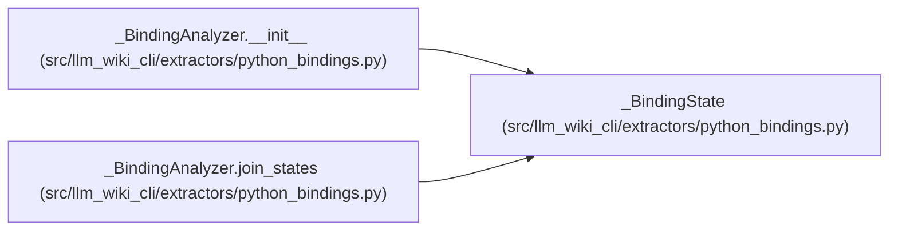

# _BindingState

**Location:** `src/llm_wiki_cli/extractors/python_bindings.py:1276`
**Kind:** Class
**Bases:** —
**Module:** [python_bindings](../modules/python_bindings.md)

**Decorators:** `@dataclass`

## Description

Private related graph; one deepcopy preserves receiver/mutator aliases.

## Attributes

| Name | Type | Default | Description |
|------|------|---------|-------------|
| `module` | `dict[str, dict]` | `dataclass_field(default_factory=dict)` | — |
| `env` | `dict[str, dict]` | `dataclass_field(default_factory=dict)` | — |
| `class_mutations` | `dict[str, set[str]]` | `dataclass_field(default_factory=dict)` | — |
| `import_mutations` | `list[dict]` | `dataclass_field(default_factory=list)` | — |
| `constructor_barriers` | `set[str]` | `dataclass_field(default_factory=set)` | — |
| `module_namespace_invalidations` | `set[str]` | `dataclass_field(default_factory=set)` | — |
| `possible_targets` | `dict[str, list[dict]]` | `dataclass_field(default_factory=dict)` | — |
| `export_invalidations` | `set[str]` | `dataclass_field(default_factory=set)` | — |
| `module_scope` | `bool` | `False` | — |

## Methods

| Method | Signature | Decorators | Description |
|--------|-----------|------------|-------------|
| `snapshot` | `()` | — | — |

## Relationships

<!-- Auto-generated relationship summary. Do not edit by hand. -->

### Summary

| Module | Methods | Attributes |
|---|---:|---|
| [python_bindings](../modules/python_bindings.md) | 1 | `class_mutations`, `constructor_barriers`, `env`, `export_invalidations`, `import_mutations`, `module`, `module_namespace_invalidations`, `module_scope`, `possible_targets` |

### References

| Reference | Kind | Source | Call sites |
|---|---|---|---:|
| `_BindingAnalyzer.__init__` | call | [python_bindings](../modules/python_bindings.md) | 1 |
| `_BindingAnalyzer.join_states` | call | [python_bindings](../modules/python_bindings.md) | 1 |
