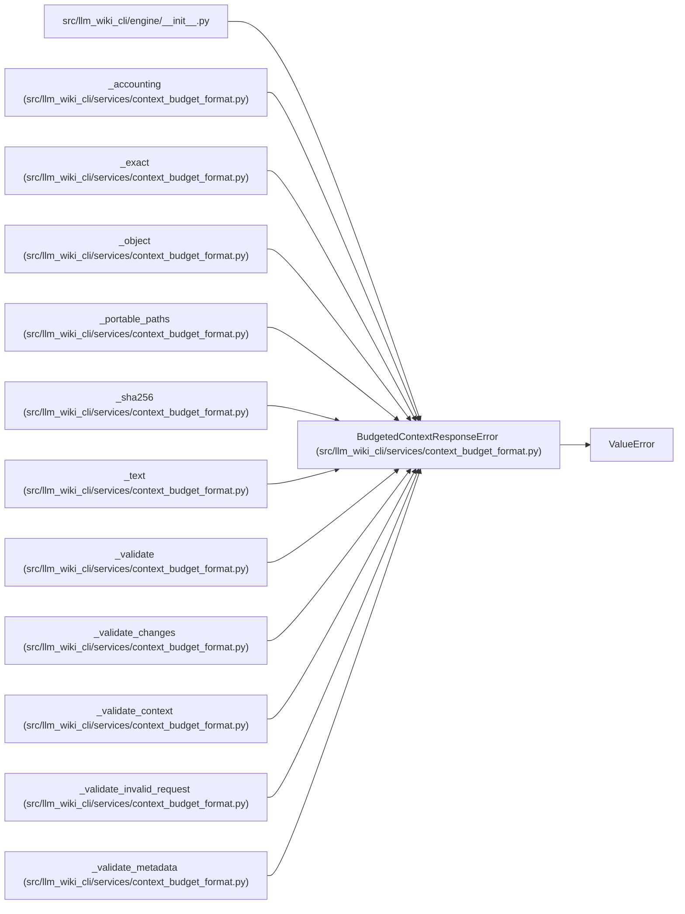

# BudgetedContextResponseError

**Location:** `src/llm_wiki_cli/services/context_budget_format.py:80`
**Kind:** Class
**Bases:** `ValueError`
**Module:** [context_budget_format](../modules/context_budget_format.md)

## Description

A budgeted context response does not follow ``llm-wiki-context/v3``.

## Attributes

*No annotated attributes found.*

## Methods

*No declared methods.*

## Relationships

<!-- Auto-generated relationship summary. Do not edit by hand. -->

### Summary

| Module | Methods | Attributes |
|---|---:|---|
| [context_budget_format](../modules/context_budget_format.md) | 0 | — |

### Structure

| Kind | Entity | Module |
|---|---|---|
| Base | `ValueError` | — |

### References

| Reference | Kind | Source | Call sites |
|---|---|---|---:|
| `__init__` | import | [engine___init__](../modules/engine___init__.md) | — |
| `_accounting` | call | [context_budget_format](../modules/context_budget_format.md) | 5 |
| `_exact` | call | [context_budget_format](../modules/context_budget_format.md) | 2 |
| `_object` | call | [context_budget_format](../modules/context_budget_format.md) | 1 |
| `_portable_paths` | call | [context_budget_format](../modules/context_budget_format.md) | 3 |
| `_sha256` | call | [context_budget_format](../modules/context_budget_format.md) | 1 |
| `_text` | call | [context_budget_format](../modules/context_budget_format.md) | 1 |
| `_validate` | call | [context_budget_format](../modules/context_budget_format.md) | 2 |
| `_validate_changes` | call | [context_budget_format](../modules/context_budget_format.md) | 9 |
| `_validate_context` | call | [context_budget_format](../modules/context_budget_format.md) | 3 |
| `_validate_invalid_request` | call | [context_budget_format](../modules/context_budget_format.md) | 1 |
| `_validate_metadata` | call | [context_budget_format](../modules/context_budget_format.md) | 2 |

> References: showing 12 of 17 logical references; 5 omitted by the 12-row generated summary limit.
