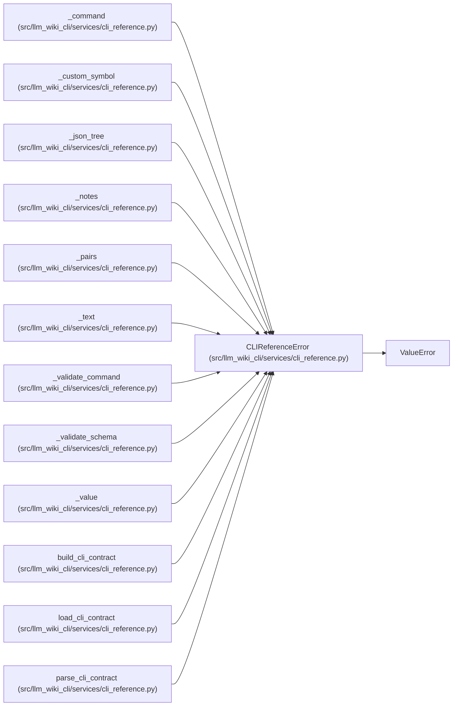

# CLIReferenceError

**Location:** `src/llm_wiki_cli/services/cli_reference.py:45`
**Kind:** Class
**Bases:** `ValueError`
**Module:** [cli_reference](../modules/cli_reference.md)

## Description

CLI declarations or supplied reference data violate the portable contract.

## Attributes

*No annotated attributes found.*

## Methods

*No declared methods.*

## Relationships

<!-- Auto-generated relationship summary. Do not edit by hand. -->

### Summary

| Module | Methods | Attributes |
|---|---:|---|
| [cli_reference](../modules/cli_reference.md) | 0 | — |

### Structure

| Kind | Entity | Module |
|---|---|---|
| Base | `ValueError` | — |

### References

| Reference | Kind | Source | Call sites |
|---|---|---|---:|
| `_command` | call | [cli_reference](../modules/cli_reference.md) | 1 |
| `_custom_symbol` | call | [cli_reference](../modules/cli_reference.md) | 1 |
| `_json_tree` | call | [cli_reference](../modules/cli_reference.md) | 2 |
| `_notes` | call | [cli_reference](../modules/cli_reference.md) | 1 |
| `_pairs` | call | [cli_reference](../modules/cli_reference.md) | 1 |
| `_text` | call | [cli_reference](../modules/cli_reference.md) | 1 |
| `_validate_command` | call | [cli_reference](../modules/cli_reference.md) | 14 |
| `_validate_schema` | call | [cli_reference](../modules/cli_reference.md) | 8 |
| `_value` | call | [cli_reference](../modules/cli_reference.md) | 3 |
| `build_cli_contract` | call | [cli_reference](../modules/cli_reference.md) | 1 |
| `load_cli_contract` | call | [cli_reference](../modules/cli_reference.md) | 1 |
| `parse_cli_contract` | call | [cli_reference](../modules/cli_reference.md) | 3 |

> References: showing 12 of 13 logical references; 1 omitted by the 12-row generated summary limit.
