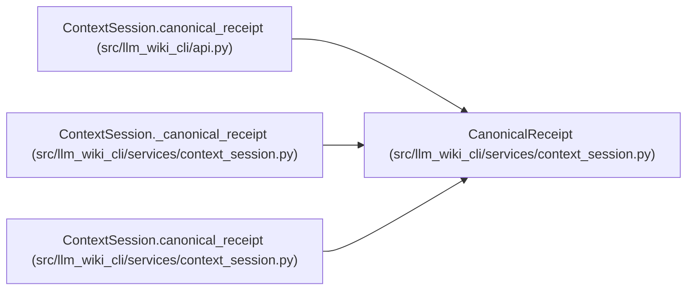

# CanonicalReceipt

**Location:** `src/llm_wiki_cli/services/context_session.py:154`
**Kind:** Class
**Bases:** —
**Module:** [context_session](../modules/context_session.md)

**Decorators:** `@dataclass(frozen=True)`

## Description

_Auto-generated from `CanonicalReceipt` in `src/llm_wiki_cli/services/context_session.py`._

## Attributes

| Name | Type | Default | Description |
|------|------|---------|-------------|
| `request_id` | `str` | *required* | — |
| `result_id` | `str` | *required* | — |
| `canonical` | `TaskContext` | *required* | — |
| `validation_scope` | `str` | *required* | — |
| `_metadata` | `Mapping[str, Any]` | *required* | — |

## Methods

| Method | Signature | Decorators | Description |
|--------|-----------|------------|-------------|
| `metadata` | `() -> dict[str, Any]` | — | — |

## Relationships

<!-- Auto-generated relationship summary. Do not edit by hand. -->

### Summary

| Module | Methods | Attributes |
|---|---:|---|
| [context_session](../modules/context_session.md) | 1 | `_metadata`, `canonical`, `request_id`, `result_id`, `validation_scope` |

### References

| Reference | Kind | Source | Call sites |
|---|---|---|---:|
| `ContextSession.canonical_receipt` | type_reference | [api](../modules/api.md) | — |
| `ContextSession._canonical_receipt` | call | [context_session](../modules/context_session.md) | 1 |
| `ContextSession.canonical_receipt` | type_reference | [context_session](../modules/context_session.md) | — |
