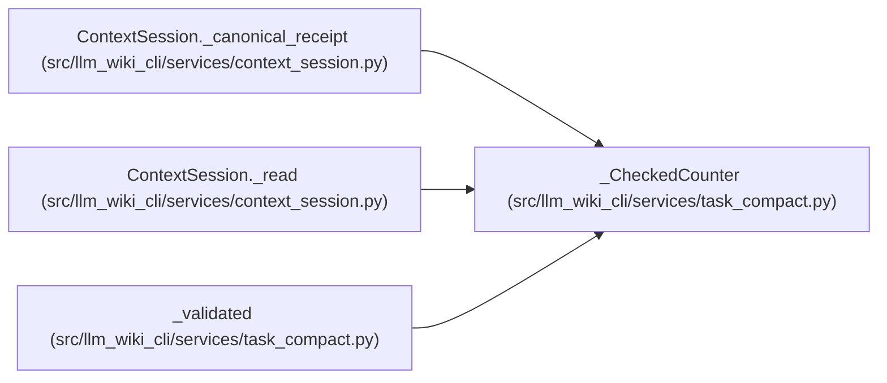

# _CheckedCounter

**Location:** `src/llm_wiki_cli/services/task_compact.py:142`
**Kind:** Class
**Bases:** —
**Module:** [task_compact](../modules/task_compact.md)

## Description

_Auto-generated from `_CheckedCounter` in `src/llm_wiki_cli/services/task_compact.py`._

## Attributes

*No annotated attributes found.*

## Methods

| Method | Signature | Decorators | Description |
|--------|-----------|------------|-------------|
| `__init__` | `(counter)` | — | — |
| `count` | `(text)` | — | — |

## Relationships

<!-- Auto-generated relationship summary. Do not edit by hand. -->

### Summary

| Module | Methods | Attributes |
|---|---:|---|
| [task_compact](../modules/task_compact.md) | 2 | — |

### References

| Reference | Kind | Source | Call sites |
|---|---|---|---:|
| `ContextSession._canonical_receipt` | call | [context_session](../modules/context_session.md) | 1 |
| `ContextSession._read` | call | [context_session](../modules/context_session.md) | 1 |
| `_validated` | call | [task_compact](../modules/task_compact.md) | 1 |
