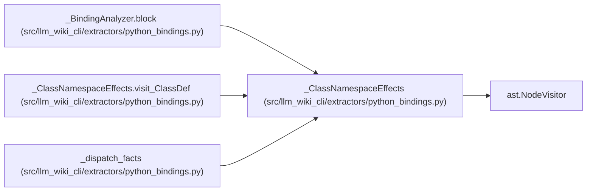

# _ClassNamespaceEffects

**Location:** `src/llm_wiki_cli/extractors/python_bindings.py:224`
**Kind:** Class
**Bases:** `ast.NodeVisitor`
**Module:** [python_bindings](../modules/python_bindings.md)

## Description

Collect executed namespace effects, retaining explicit scope boundaries.

## Attributes

*No annotated attributes found.*

## Methods

| Method | Signature | Decorators | Description |
|--------|-----------|------------|-------------|
| `__init__` | `(node, module, *, annotations_eager, side_effects = None)` | — | — |
| `_store` | `(name, binding = None)` | — | — |
| `_helper` | `(node)` | — | — |
| `_namespace` | `(node)` | — | — |
| `_value` | `(node)` | — | — |
| `_target` | `(node, binding = None, *, captured_namespace = None, evaluated = False)` | — | — |
| `visit_Assign` | `(node)` | — | — |
| `visit_AnnAssign` | `(node)` | — | — |
| `visit_AugAssign` | `(node)` | — | — |
| `visit_Delete` | `(node)` | — | — |
| `visit_NamedExpr` | `(node)` | — | — |
| `_header` | `(node)` | — | — |
| `visit_FunctionDef` | `(node: ast.FunctionDef \| ast.AsyncFunctionDef)` | — | — |
| `visit_AsyncFunctionDef` | `(node)` | — | — |
| `visit_ClassDef` | `(node)` | — | — |
| `visit_Lambda` | `(node)` | — | — |
| `visit_Import` | `(node: ast.Import \| ast.ImportFrom)` | — | — |
| `visit_ImportFrom` | `(node)` | — | — |
| `visit_For` | `(node: ast.For \| ast.AsyncFor)` | — | — |
| `visit_AsyncFor` | `(node)` | — | — |
| `visit_With` | `(node: ast.With \| ast.AsyncWith)` | — | — |
| `visit_AsyncWith` | `(node)` | — | — |
| `visit_ExceptHandler` | `(node)` | — | — |
| `visit_MatchAs` | `(node)` | — | — |
| `visit_MatchStar` | `(node)` | — | — |
| `visit_MatchMapping` | `(node)` | — | — |
| `_branches` | `(branches)` | — | — |
| `_join_binding` | `(values)` | `@staticmethod` | — |
| `visit_If` | `(node: ast.If \| ast.While)` | — | — |
| `visit_While` | `(node)` | — | — |
| `visit_Try` | `(node)` | — | — |
| `_retain_prefix_bindings` | `(base, start)` | — | — |
| `visit_Match` | `(node)` | — | — |
| `visit_TypeAlias` | `(node)` | — | — |
| `_comprehension` | `(node)` | — | — |
| `visit_Attribute` | `(node)` | — | — |
| `visit_Call` | `(node)` | — | — |
| `_mutate_namespace` | `(namespace, method, args, keywords)` | — | — |

## Relationships

<!-- Auto-generated relationship summary. Do not edit by hand. -->

### Summary

| Module | Methods | Attributes |
|---|---:|---|
| [python_bindings](../modules/python_bindings.md) | 38 | — |

### Structure

| Kind | Entity | Module |
|---|---|---|
| Base | `ast.NodeVisitor` | — |

### References

| Reference | Kind | Source | Call sites |
|---|---|---|---:|
| `_BindingAnalyzer.block` | call | [python_bindings](../modules/python_bindings.md) | 1 |
| `_ClassNamespaceEffects.visit_ClassDef` | call | [python_bindings](../modules/python_bindings.md) | 1 |
| `_dispatch_facts` | call | [python_bindings](../modules/python_bindings.md) | 1 |
