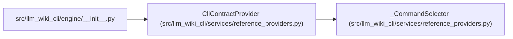

# CliContractProvider

**Location:** `src/llm_wiki_cli/services/reference_providers.py:145`
**Kind:** Class
**Bases:** `_CommandSelector`
**Module:** [reference_providers](../modules/reference_providers.md)

## Description

The installed ``llm-wiki`` command-line contract.

## Attributes

*No annotated attributes found.*

## Methods

| Method | Signature | Decorators | Description |
|--------|-----------|------------|-------------|
| `capture` | `() -> Any` | — | — |
| `validate_contract` | `(contract: Any) -> None` | — | — |

## Relationships

<!-- Auto-generated relationship summary. Do not edit by hand. -->

### Summary

| Module | Methods | Attributes |
|---|---:|---|
| [reference_providers](../modules/reference_providers.md) | 2 | — |

### Structure

| Kind | Entity | Module |
|---|---|---|
| Base | `_CommandSelector` | [reference_providers](../modules/reference_providers.md) |

### References

| Reference | Kind | Source | Call sites |
|---|---|---|---:|
| `__init__` | import | [engine___init__](../modules/engine___init__.md) | — |
