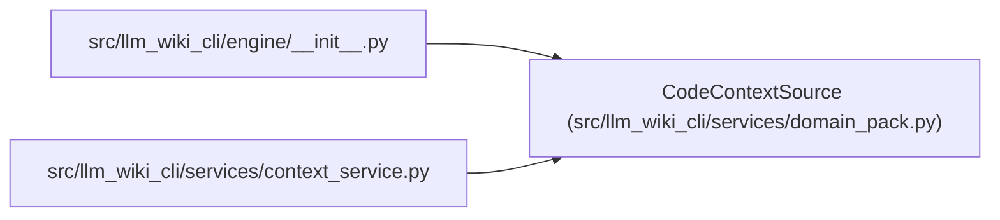

# CodeContextSource

**Location:** `src/llm_wiki_cli/services/domain_pack.py:124`
**Kind:** Class
**Bases:** —
**Module:** [domain_pack](../modules/domain_pack.md)

## Description

Code context: import neighbors, then classes and functions by detail.

## Attributes

*No annotated attributes found.*

## Methods

| Method | Signature | Decorators | Description |
|--------|-----------|------------|-------------|
| `module_for_path` | `(filepath: str) -> str \| None` | `@staticmethod` | Convert ``"src/llm_wiki_cli/config.py"`` to ``"llm_wiki_cli.config"``. |
| `related_sources` | `(inventory: Mapping[str, Mapping[str, Any]]) -> dict[str, set[str]]` | — | A bidirectional import adjacency map of the inventory. |
| `deep_entry` | `(file_data: Mapping[str, Any]) -> dict[str, Any]` | `@staticmethod` | Full detail: classes with methods, params, docstrings, imports. |
| `slim_entry` | `(file_data: Mapping[str, Any]) -> dict[str, Any]` | `@staticmethod` | Slim detail: class names/bases/line, function names/lines. |
| `summary_entry` | `(file_data: Mapping[str, Any]) -> dict[str, Any]` | `@staticmethod` | Names only: lists of class names and function names. |
| `entry` | `(data: Mapping[str, Any], detail: ContextDetail) -> dict[str, Any]` | — | — |

## Relationships

<!-- Auto-generated relationship summary. Do not edit by hand. -->

### Summary

| Module | Methods | Attributes |
|---|---:|---|
| [domain_pack](../modules/domain_pack.md) | 6 | — |

### References

| Reference | Kind | Source | Call sites |
|---|---|---|---:|
| `__init__` | import | [engine___init__](../modules/engine___init__.md) | — |
| `context_service` | import | [context_service](../modules/context_service.md) | — |
