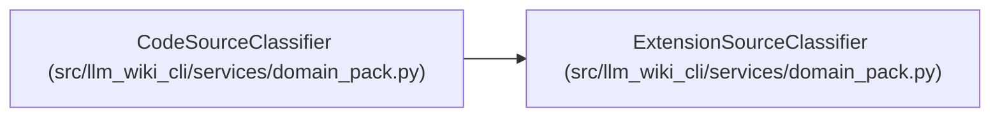

# CodeSourceClassifier

**Location:** `src/llm_wiki_cli/services/domain_pack.py:468`
**Kind:** Class
**Bases:** `ExtensionSourceClassifier`
**Module:** [domain_pack](../modules/domain_pack.md)

## Description

The built-in languages; Go ``_test.go`` files are opt-in.

The language table is read live from the extractors, which are imported
only when a source is first classified.

## Attributes

*No annotated attributes found.*

## Methods

| Method | Signature | Decorators | Description |
|--------|-----------|------------|-------------|
| `__init__` | `() -> None` | — | — |
| `_kind_table` | `() -> Mapping[str, tuple[str, ...]]` | — | — |
| `inventory_language` | `(path: str) -> str \| None` | — | — |

## Relationships

<!-- Auto-generated relationship summary. Do not edit by hand. -->

### Summary

| Module | Methods | Attributes |
|---|---:|---|
| [domain_pack](../modules/domain_pack.md) | 3 | — |

### Structure

| Kind | Entity | Module |
|---|---|---|
| Base | `ExtensionSourceClassifier` | [domain_pack](../modules/domain_pack.md) |
