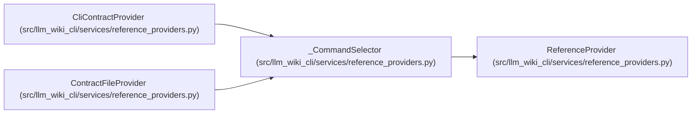

# _CommandSelector

**Location:** `src/llm_wiki_cli/services/reference_providers.py:113`
**Kind:** Class
**Bases:** `ReferenceProvider`
**Module:** [reference_providers](../modules/reference_providers.md)

## Description

Dependencies select a command subtree: ``{"reference", "command": [...]}``.

## Attributes

*No annotated attributes found.*

## Methods

| Method | Signature | Decorators | Description |
|--------|-----------|------------|-------------|
| `normalize_selector` | `(dependency: Mapping[str, Any], field: str) -> dict[str, Any]` | — | — |
| `validate_contract` | `(contract: Any) -> None` | — | — |
| `select` | `(contract: Any, dependency: Mapping[str, Any]) -> str \| None` | — | — |

## Relationships

<!-- Auto-generated relationship summary. Do not edit by hand. -->

### Summary

| Module | Methods | Attributes |
|---|---:|---|
| [reference_providers](../modules/reference_providers.md) | 3 | — |

### Structure

| Kind | Entity | Module |
|---|---|---|
| Base | `ReferenceProvider` | [reference_providers](../modules/reference_providers.md) |
| Subclass | `CliContractProvider` | [reference_providers](../modules/reference_providers.md) |
| Subclass | `ContractFileProvider` | [reference_providers](../modules/reference_providers.md) |
