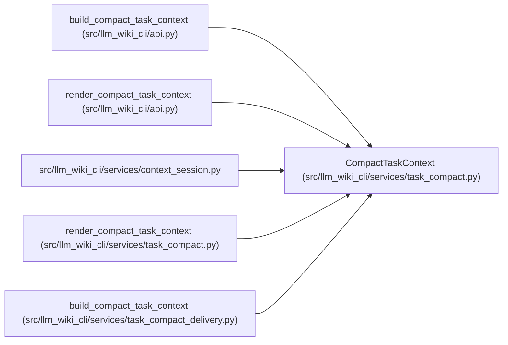

# CompactTaskContext

**Location:** `src/llm_wiki_cli/services/task_compact.py:85`
**Kind:** Class
**Bases:** —
**Module:** [task_compact](../modules/task_compact.md)

**Decorators:** `@dataclass(frozen=True)`

## Description

_Auto-generated from `CompactTaskContext` in `src/llm_wiki_cli/services/task_compact.py`._

## Attributes

| Name | Type | Default | Description |
|------|------|---------|-------------|
| `ok` | `bool` | *required* | — |
| `rendered` | `str` | *required* | — |
| `accounting` | `Mapping[str, Any]` | *required* | — |
| `canonical_text` | `str` | *required* | — |
| `canonical_accounting` | `Mapping[str, Any]` | *required* | — |
| `error` | `str \| None` | `None` | — |
| `schema_version` | `str` | `COMPACT_SCHEMA` | — |
| `diagnostic_rendered` | `str` | `''` | — |

## Methods

| Method | Signature | Decorators | Description |
|--------|-----------|------------|-------------|
| `__post_init__` | `()` | — | — |
| `view_id` | `()` | `@property` | — |
| `to_payload` | `()` | — | — |

## Relationships

<!-- Auto-generated relationship summary. Do not edit by hand. -->

### Summary

| Module | Methods | Attributes |
|---|---:|---|
| [task_compact](../modules/task_compact.md) | 3 | `accounting`, `canonical_accounting`, `canonical_text`, `diagnostic_rendered`, `error`, `ok`, `rendered`, `schema_version` |

### References

| Reference | Kind | Source | Call sites |
|---|---|---|---:|
| `build_compact_task_context` | type_reference | [api](../modules/api.md) | — |
| `render_compact_task_context` | type_reference | [api](../modules/api.md) | — |
| `context_session` | import | [context_session](../modules/context_session.md) | — |
| `render_compact_task_context` | call | [task_compact](../modules/task_compact.md) | 2 |
| `build_compact_task_context` | type_reference | [task_compact_delivery](../modules/task_compact_delivery.md) | — |
