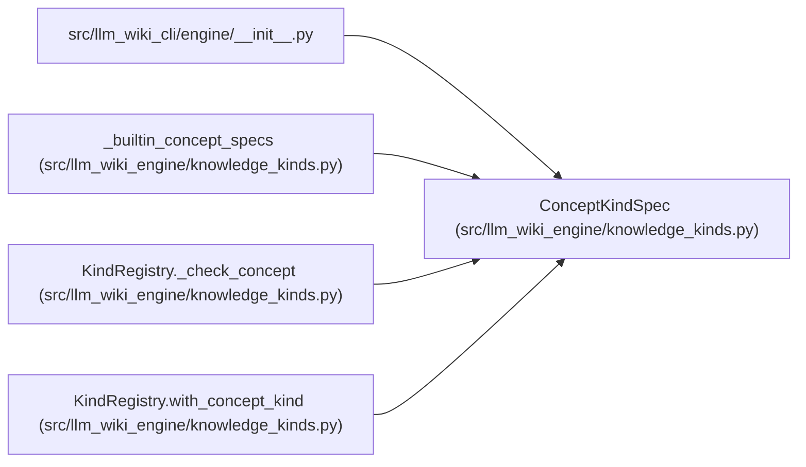

# ConceptKindSpec

**Location:** `src/llm_wiki_engine/knowledge_kinds.py:68`
**Kind:** Class
**Bases:** —
**Module:** [knowledge_kinds](../modules/knowledge_kinds.md)

**Decorators:** `@dataclass(frozen=True)`

## Description

One concept kind and the page kinds its concepts may appear on.

## Attributes

| Name | Type | Default | Description |
|------|------|---------|-------------|
| `name` | `str` | *required* | — |
| `page_kinds` | `tuple[PageKind, ...]` | *required* | — |
| `document_only` | `bool` | `False` | — |
| `description` | `str` | `''` | — |

## Methods

| Method | Signature | Decorators | Description |
|--------|-----------|------------|-------------|
| `__post_init__` | `() -> None` | — | — |

## Relationships

<!-- Auto-generated relationship summary. Do not edit by hand. -->

### Summary

| Module | Methods | Attributes |
|---|---:|---|
| [knowledge_kinds](../modules/knowledge_kinds.md) | 1 | `description`, `document_only`, `name`, `page_kinds` |

### References

| Reference | Kind | Source | Call sites |
|---|---|---|---:|
| `__init__` | import | [engine___init__](../modules/engine___init__.md) | — |
| `_builtin_concept_specs` | call | [knowledge_kinds](../modules/knowledge_kinds.md) | 1 |
| `_builtin_concept_specs` | type_reference | [knowledge_kinds](../modules/knowledge_kinds.md) | — |
| `KindRegistry._check_concept` | type_reference | [knowledge_kinds](../modules/knowledge_kinds.md) | — |
| `KindRegistry.with_concept_kind` | type_reference | [knowledge_kinds](../modules/knowledge_kinds.md) | — |
