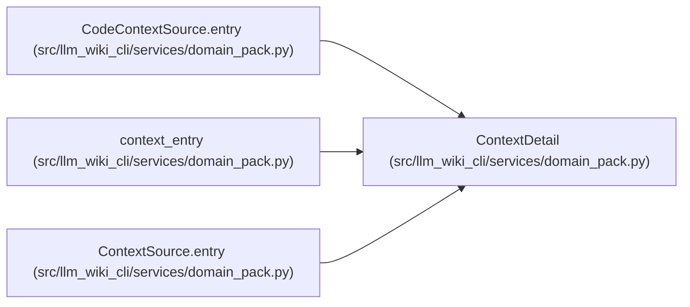

# ContextDetail

**Location:** `src/llm_wiki_cli/services/domain_pack.py:254`
**Kind:** Type alias
**Bases:** —
**Module:** [domain_pack](../modules/domain_pack.md)
**Target:** `Literal['deep', 'slim', 'summary']`

## Description

_Auto-generated from `ContextDetail` in `src/llm_wiki_cli/services/domain_pack.py`._

## Attributes

*See the alias definition for its member types.*

## Methods

*See the alias definition for callable and member types.*

## Relationships

<!-- Auto-generated relationship summary. Do not edit by hand. -->

### Summary

| Module | Methods | Attributes |
|---|---:|---|
| [domain_pack](../modules/domain_pack.md) | 0 | — |

### References

| Reference | Kind | Source | Call sites |
|---|---|---|---:|
| `CodeContextSource.entry` | type_reference | [domain_pack](../modules/domain_pack.md) | — |
| `context_entry` | type_reference | [domain_pack](../modules/domain_pack.md) | — |
| `ContextSource.entry` | type_reference | [domain_pack](../modules/domain_pack.md) | — |
