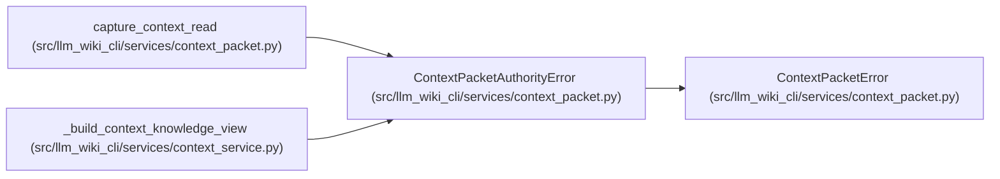

# ContextPacketAuthorityError

**Location:** `src/llm_wiki_cli/services/context_packet.py:267`
**Kind:** Class
**Bases:** `ContextPacketError`
**Module:** [context_packet](../modules/context_packet.md)

## Description

Ordinary authority refused a read; only explicit complete recovery can restore it.

Carries the bounded `maintenance-authority-unavailable` diagnostic shared by packet API, CLI and MCP. It retains original loader issues locally while rendering only allowlisted maintenance causes, unavailable native evidence and exact recovery requirements. Recovery uses the original wiki/source boundaries, one matching complete committed snapshot and the existing adoption identity. The command template neither finds a backup nor guarantees that a damaged tree satisfies the recovery owner's preconditions; missing projections and conflicting authority can still refuse. The exception performs no writes or fallback promotion.

## Attributes

*No annotated attributes found.*

## Methods

| Method | Signature | Decorators | Description |
|--------|-----------|------------|-------------|
| `__init__` | `(issues)` | — | — |

## Relationships

<!-- Auto-generated relationship summary. Do not edit by hand. -->

### Summary

| Module | Methods | Attributes |
|---|---:|---|
| [context_packet](../modules/context_packet.md) | 1 | — |

### Structure

| Kind | Entity | Module |
|---|---|---|
| Base | `ContextPacketError` | [context_packet](../modules/context_packet.md) |

### References

| Reference | Kind | Source | Call sites |
|---|---|---|---:|
| `capture_context_read` | call | [context_packet](../modules/context_packet.md) | 1 |
| `_build_context_knowledge_view` | call | [context_service](../modules/context_service.md) | 1 |
