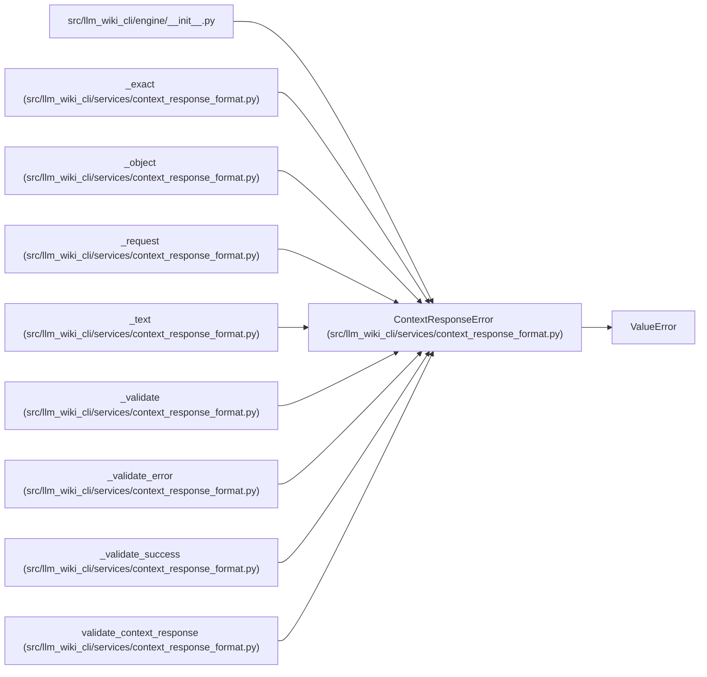

# ContextResponseError

**Location:** `src/llm_wiki_cli/services/context_response_format.py:41`
**Kind:** Class
**Bases:** `ValueError`
**Module:** [context_response_format](../modules/context_response_format.md)

## Description

A context protocol response does not follow its format.

## Attributes

*No annotated attributes found.*

## Methods

*No declared methods.*

## Relationships

<!-- Auto-generated relationship summary. Do not edit by hand. -->

### Summary

| Module | Methods | Attributes |
|---|---:|---|
| [context_response_format](../modules/context_response_format.md) | 0 | — |

### Structure

| Kind | Entity | Module |
|---|---|---|
| Base | `ValueError` | — |

### References

| Reference | Kind | Source | Call sites |
|---|---|---|---:|
| `__init__` | import | [engine___init__](../modules/engine___init__.md) | — |
| `_exact` | call | [context_response_format](../modules/context_response_format.md) | 2 |
| `_object` | call | [context_response_format](../modules/context_response_format.md) | 1 |
| `_request` | call | [context_response_format](../modules/context_response_format.md) | 3 |
| `_text` | call | [context_response_format](../modules/context_response_format.md) | 1 |
| `_validate` | call | [context_response_format](../modules/context_response_format.md) | 2 |
| `_validate_error` | call | [context_response_format](../modules/context_response_format.md) | 4 |
| `_validate_success` | call | [context_response_format](../modules/context_response_format.md) | 10 |
| `validate_context_response` | call | [context_response_format](../modules/context_response_format.md) | 1 |
