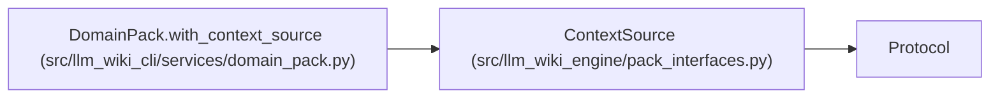

# ContextSource

**Location:** `src/llm_wiki_engine/pack_interfaces.py:182`
**Kind:** Class
**Bases:** `Protocol`
**Module:** [pack_interfaces](../modules/pack_interfaces.md)

**Decorators:** `@runtime_checkable`

## Description

How sources relate and appear in budgeted context.

## Attributes

*No annotated attributes found.*

## Methods

| Method | Signature | Decorators | Description |
|--------|-----------|------------|-------------|
| `related_sources` | `(inventory: Mapping[str, Mapping[str, Any]]) -> Mapping[str, Iterable[str]]` | — | Return ``{source path: related source paths}``. |
| `entry` | `(data: Mapping[str, Any], detail: ContextDetail) -> Mapping[str, Any]` | — | Return the context entry of one source at ``detail``. |

## Relationships

<!-- Auto-generated relationship summary. Do not edit by hand. -->

### Summary

| Module | Methods | Attributes |
|---|---:|---|
| [pack_interfaces](../modules/pack_interfaces.md) | 2 | — |

### Structure

| Kind | Entity | Module |
|---|---|---|
| Base | `Protocol` | — |

### References

| Reference | Kind | Source | Call sites |
|---|---|---|---:|
| `DomainPack.with_context_source` | type_reference | [domain_pack](../modules/domain_pack.md) | — |
