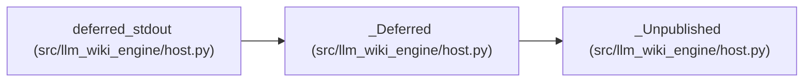

# _Deferred

**Location:** `src/llm_wiki_engine/host.py:248`
**Kind:** Class
**Bases:** `_Unpublished`
**Module:** [host](../modules/host.md)

## Description

_Auto-generated from `_Deferred` in `src/llm_wiki_engine/host.py`._

## Attributes

*No annotated attributes found.*

## Methods

| Method | Signature | Decorators | Description |
|--------|-----------|------------|-------------|
| `__init__` | `(output)` | — | — |
| `write` | `(text: str) -> int` | — | — |

## Relationships

<!-- Auto-generated relationship summary. Do not edit by hand. -->

### Summary

| Module | Methods | Attributes |
|---|---:|---|
| [host](../modules/host.md) | 2 | — |

### Structure

| Kind | Entity | Module |
|---|---|---|
| Base | `_Unpublished` | [host](../modules/host.md) |

### References

| Reference | Kind | Source | Call sites |
|---|---|---|---:|
| `deferred_stdout` | call | [host](../modules/host.md) | 1 |
