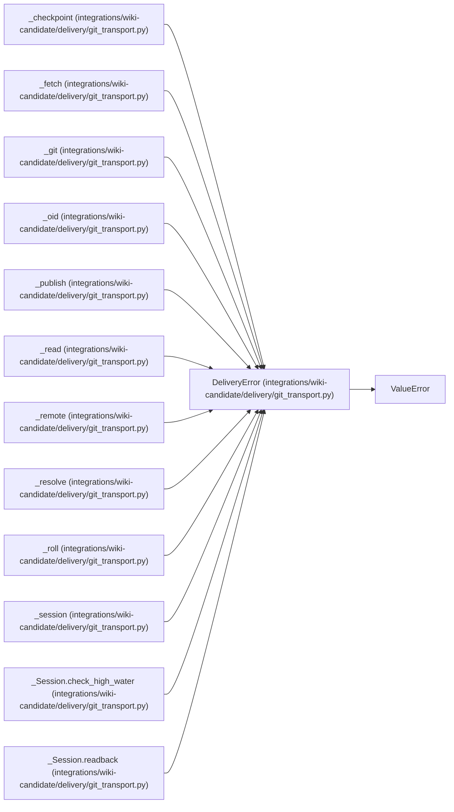

# DeliveryError

**Location:** `integrations/wiki-candidate/delivery/git_transport.py:46`
**Kind:** Class
**Bases:** `ValueError`
**Module:** [git_transport](../modules/git_transport.md)

## Description

Delivery could not be verified; no local success checkpoint is available.

## Attributes

*No annotated attributes found.*

## Methods

*No declared methods.*

## Relationships

<!-- Auto-generated relationship summary. Do not edit by hand. -->

### Summary

| Module | Methods | Attributes |
|---|---:|---|
| [git_transport](../modules/git_transport.md) | 0 | — |

### Structure

| Kind | Entity | Module |
|---|---|---|
| Base | `ValueError` | — |

### References

| Reference | Kind | Source | Call sites |
|---|---|---|---:|
| `_checkpoint` | call | [git_transport](../modules/git_transport.md) | 7 |
| `_fetch` | call | [git_transport](../modules/git_transport.md) | 1 |
| `_git` | call | [git_transport](../modules/git_transport.md) | 3 |
| `_oid` | call | [git_transport](../modules/git_transport.md) | 1 |
| `_publish` | call | [git_transport](../modules/git_transport.md) | 2 |
| `_read` | call | [git_transport](../modules/git_transport.md) | 5 |
| `_remote` | call | [git_transport](../modules/git_transport.md) | 3 |
| `_resolve` | call | [git_transport](../modules/git_transport.md) | 4 |
| `_roll` | call | [git_transport](../modules/git_transport.md) | 6 |
| `_session` | call | [git_transport](../modules/git_transport.md) | 4 |
| `_Session.check_high_water` | call | [git_transport](../modules/git_transport.md) | 2 |
| `_Session.readback` | call | [git_transport](../modules/git_transport.md) | 1 |

> References: showing 12 of 17 logical references; 5 omitted by the 12-row generated summary limit.
