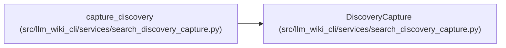

# DiscoveryCapture

**Location:** `src/llm_wiki_cli/services/search_discovery_capture.py:22`
**Kind:** Class
**Bases:** —
**Module:** [search_discovery_capture](../modules/search_discovery_capture.md)

**Decorators:** `@dataclass`

## Description

_Auto-generated from `DiscoveryCapture` in `src/llm_wiki_cli/services/search_discovery_capture.py`._

## Attributes

| Name | Type | Default | Description |
|------|------|---------|-------------|
| `manifest` | `SyncManifest \| None` | *required* | — |
| `native_payload` | `dict[str, Any]` | *required* | — |
| `recorded_reviews` | `dict[str, Any]` | *required* | — |
| `wiki_reads` | `StorageReadSession` | *required* | — |
| `native` | `ScopedKnowledgeRead \| None` | *required* | — |
| `absent_paths` | `tuple[str, ...]` | *required* | — |
| `guard_marker_bytes` | `int` | `0` | — |

## Methods

| Method | Signature | Decorators | Description |
|--------|-----------|------------|-------------|
| `finish` | `()` | — | — |

## Relationships

<!-- Auto-generated relationship summary. Do not edit by hand. -->

### Summary

| Module | Methods | Attributes |
|---|---:|---|
| [search_discovery_capture](../modules/search_discovery_capture.md) | 1 | `absent_paths`, `guard_marker_bytes`, `manifest`, `native`, `native_payload`, `recorded_reviews`, `wiki_reads` |

### References

| Reference | Kind | Source | Call sites |
|---|---|---|---:|
| `capture_discovery` | call | [search_discovery_capture](../modules/search_discovery_capture.md) | 1 |
| `capture_discovery` | type_reference | [search_discovery_capture](../modules/search_discovery_capture.md) | — |
