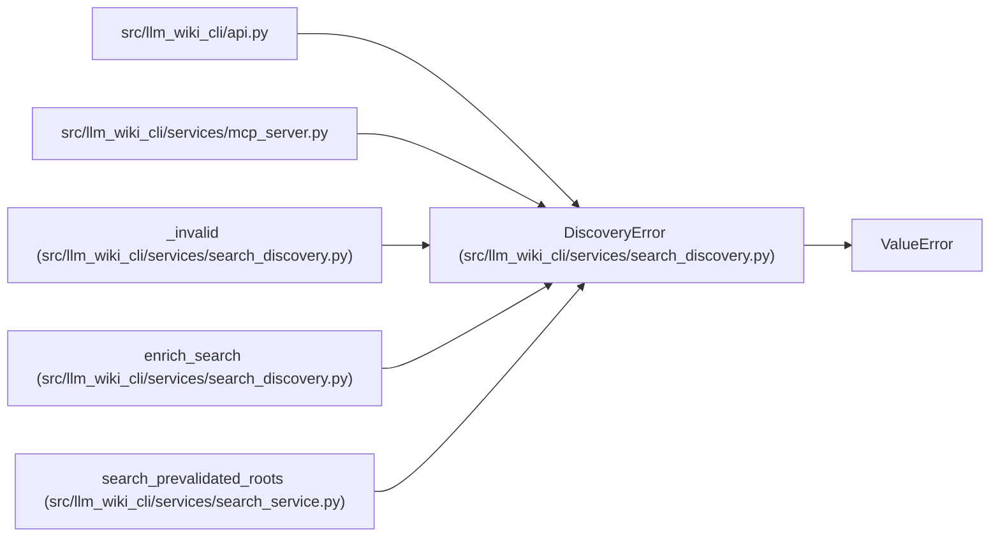

# DiscoveryError

**Location:** `src/llm_wiki_cli/services/search_discovery.py:33`
**Kind:** Class
**Bases:** `ValueError`
**Module:** [search_discovery](../modules/search_discovery.md)

## Description

Safe fixed diagnostics without reflecting captured content.

## Attributes

*No annotated attributes found.*

## Methods

| Method | Signature | Decorators | Description |
|--------|-----------|------------|-------------|
| `__init__` | `(code: str, field: str, *, required_bytes: int \| None = None)` | — | — |

## Relationships

<!-- Auto-generated relationship summary. Do not edit by hand. -->

### Summary

| Module | Methods | Attributes |
|---|---:|---|
| [search_discovery](../modules/search_discovery.md) | 1 | — |

### Structure

| Kind | Entity | Module |
|---|---|---|
| Base | `ValueError` | — |

### References

| Reference | Kind | Source | Call sites |
|---|---|---|---:|
| `api` | import | [api](../modules/api.md) | — |
| `mcp_server` | import | [mcp_server](../modules/mcp_server.md) | — |
| `_invalid` | call | [search_discovery](../modules/search_discovery.md) | 1 |
| `enrich_search` | call | [search_discovery](../modules/search_discovery.md) | 1 |
| `search_prevalidated_roots` | call | [search_service](../modules/search_service.md) | 1 |
