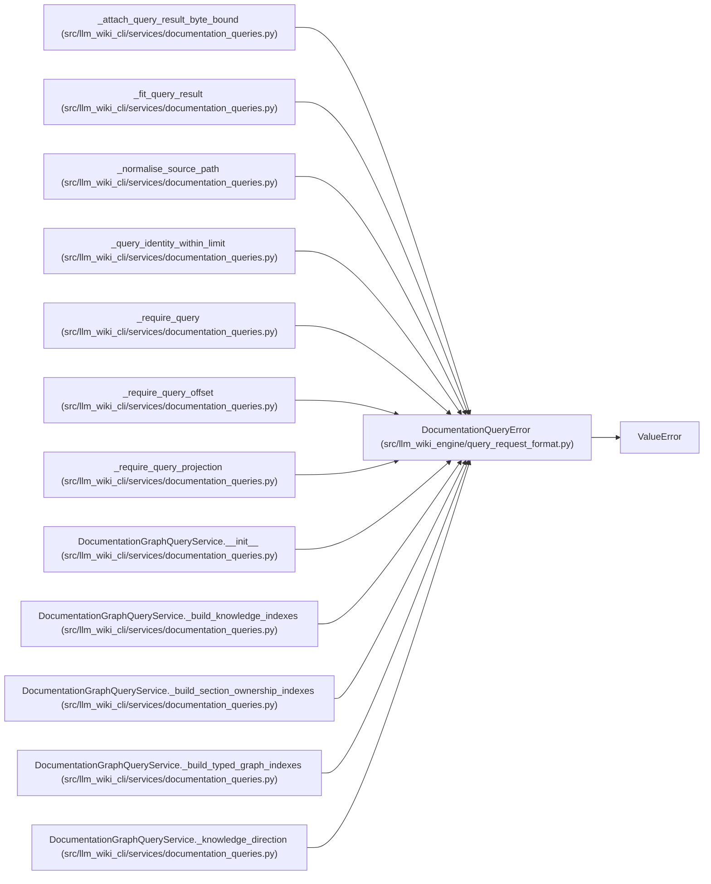

# DocumentationQueryError

**Location:** `src/llm_wiki_engine/query_request_format.py:30`
**Kind:** Class
**Bases:** `ValueError`
**Module:** [query_request_format](../modules/query_request_format.md)

## Description

Raised when a documentation graph query request is invalid.

## Attributes

*No annotated attributes found.*

## Methods

| Method | Signature | Decorators | Description |
|--------|-----------|------------|-------------|
| `__init__` | `(message: str = '', *, field: str \| None = None)` | — | — |

## Relationships

<!-- Auto-generated relationship summary. Do not edit by hand. -->

### Summary

| Module | Methods | Attributes |
|---|---:|---|
| [query_request_format](../modules/query_request_format.md) | 1 | — |

### Structure

| Kind | Entity | Module |
|---|---|---|
| Base | `ValueError` | — |

### References

| Reference | Kind | Source | Call sites |
|---|---|---|---:|
| `_attach_query_result_byte_bound` | call | [documentation_queries](../modules/documentation_queries.md) | 1 |
| `_fit_query_result` | call | [documentation_queries](../modules/documentation_queries.md) | 1 |
| `_normalise_source_path` | call | [documentation_queries](../modules/documentation_queries.md) | 5 |
| `_query_identity_within_limit` | call | [documentation_queries](../modules/documentation_queries.md) | 1 |
| `_require_query` | call | [documentation_queries](../modules/documentation_queries.md) | 1 |
| `_require_query_offset` | call | [documentation_queries](../modules/documentation_queries.md) | 1 |
| `_require_query_projection` | call | [documentation_queries](../modules/documentation_queries.md) | 1 |
| `DocumentationGraphQueryService.__init__` | call | [documentation_queries](../modules/documentation_queries.md) | 4 |
| `DocumentationGraphQueryService._build_knowledge_indexes` | call | [documentation_queries](../modules/documentation_queries.md) | 6 |
| `DocumentationGraphQueryService._build_section_ownership_indexes` | call | [documentation_queries](../modules/documentation_queries.md) | 6 |
| `DocumentationGraphQueryService._build_typed_graph_indexes` | call | [documentation_queries](../modules/documentation_queries.md) | 3 |
| `DocumentationGraphQueryService._knowledge_direction` | call | [documentation_queries](../modules/documentation_queries.md) | 1 |

> References: showing 12 of 32 logical references; 20 omitted by the 12-row generated summary limit.
