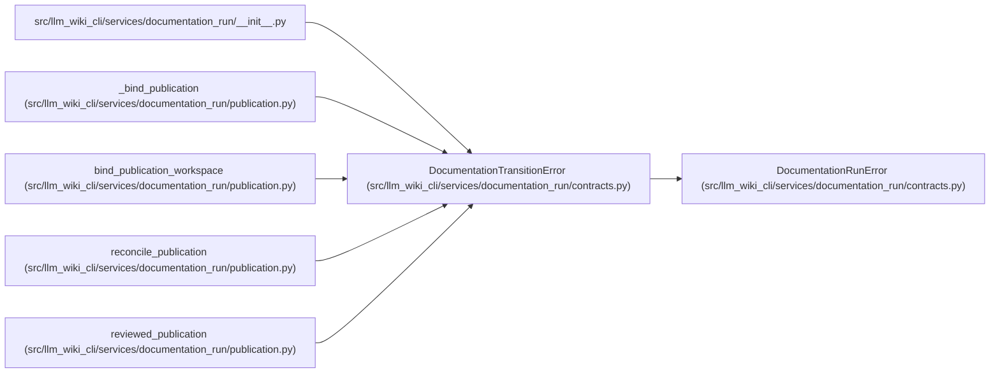

# DocumentationTransitionError

**Location:** `src/llm_wiki_cli/services/documentation_run/contracts.py:306`
**Kind:** Class
**Bases:** `DocumentationRunError`
**Module:** [documentation_run_contracts](../modules/documentation_run_contracts.md)

## Description

Raised when a stage transition violates the lifecycle graph.

## Attributes

*No annotated attributes found.*

## Methods

*No declared methods.*

## Relationships

<!-- Auto-generated relationship summary. Do not edit by hand. -->

### Summary

| Module | Methods | Attributes |
|---|---:|---|
| [documentation_run_contracts](../modules/documentation_run_contracts.md) | 0 | — |

### Structure

| Kind | Entity | Module |
|---|---|---|
| Base | `DocumentationRunError` | [documentation_run_contracts](../modules/documentation_run_contracts.md) |

### References

| Reference | Kind | Source | Call sites |
|---|---|---|---:|
| `__init__` | import | [documentation_run___init__](../modules/documentation_run___init__.md) | — |
| `_bind_publication` | call | [publication](../modules/publication.md) | 2 |
| `bind_publication_workspace` | call | [publication](../modules/publication.md) | 1 |
| `reconcile_publication` | call | [publication](../modules/publication.md) | 5 |
| `reviewed_publication` | call | [publication](../modules/publication.md) | 2 |
