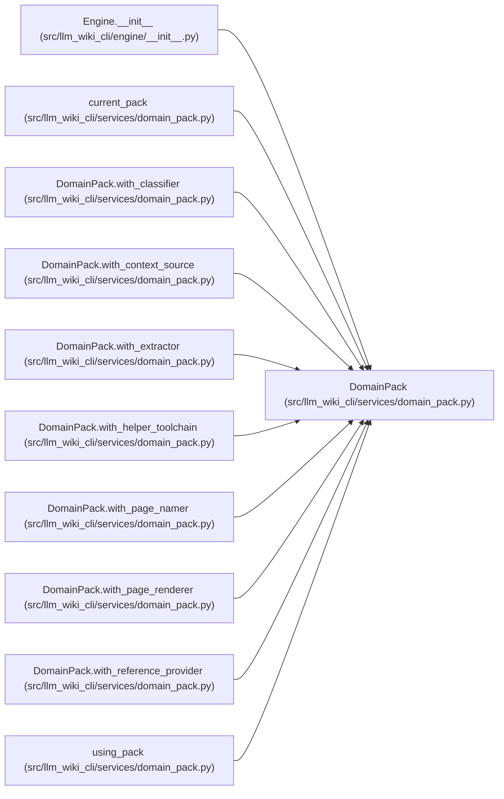

# DomainPack

**Location:** `src/llm_wiki_cli/services/domain_pack.py:755`
**Kind:** Class
**Bases:** —
**Module:** [domain_pack](../modules/domain_pack.md)

**Decorators:** `@dataclass(frozen=True)`

## Description

A named set of domain decisions: classification, naming, rendering, context,
references and analysis helpers.

## Attributes

| Name | Type | Default | Description |
|------|------|---------|-------------|
| `name` | `str` | *required* | — |
| `classifier` | `SourceClassifier` | *required* | — |
| `page_namer` | `PageNamer` | `field(default_factory=StemPageNamer)` | — |
| `page_renderer` | `PageRenderer` | `field(default_factory=BuiltInPageRenderer)` | — |
| `context_source` | `ContextSource` | `field(default_factory=CodeContextSource)` | — |
| `reference_providers` | `tuple[ReferenceProvider, ...]` | `BUILTIN_REFERENCE_PROVIDERS` | — |
| `helper_toolchain` | `HelperToolchain` | `field(default_factory=BundledHelperToolchain)` | — |
| `extractors` | `Mapping[str, str]` | `field(default_factory=dict, hash=False)` | — |

## Methods

| Method | Signature | Decorators | Description |
|--------|-----------|------------|-------------|
| `__post_init__` | `() -> None` | — | — |
| `with_classifier` | `(classifier: SourceClassifier) -> DomainPack` | — | A copy of this pack that classifies sources with ``classifier``. |
| `with_page_namer` | `(page_namer: PageNamer) -> DomainPack` | — | A copy of this pack that names pages with ``page_namer``. |
| `with_page_renderer` | `(page_renderer: PageRenderer) -> DomainPack` | — | A copy of this pack that writes pages with ``page_renderer``. |
| `with_context_source` | `(context_source: ContextSource) -> DomainPack` | — | A copy of this pack that builds budgeted context with ``context_source``. |
| `with_reference_provider` | `(provider: ReferenceProvider) -> DomainPack` | — | A copy of this pack that also serves ``provider``, replacing one of the same kind. |
| `with_extractor` | `(source_kind: str, entry_point: str) -> DomainPack` | — | A copy of this pack that extracts ``source_kind`` with ``entry_point``. |
| `with_helper_toolchain` | `(helper_toolchain: HelperToolchain) -> DomainPack` | — | A copy of this pack that prepares analysis helpers with ``helper_toolchain``. |
| `describe` | `() -> dict[str, Any]` | — | A JSON-ready summary of the pack. |

## Relationships

<!-- Auto-generated relationship summary. Do not edit by hand. -->

### Summary

| Module | Methods | Attributes |
|---|---:|---|
| [domain_pack](../modules/domain_pack.md) | 9 | `classifier`, `context_source`, `extractors`, `helper_toolchain`, `name`, `page_namer`, `page_renderer`, `reference_providers` |

### References

| Reference | Kind | Source | Call sites |
|---|---|---|---:|
| `Engine.__init__` | type_reference | [engine___init__](../modules/engine___init__.md) | — |
| `current_pack` | type_reference | [domain_pack](../modules/domain_pack.md) | — |
| `DomainPack.with_classifier` | type_reference | [domain_pack](../modules/domain_pack.md) | — |
| `DomainPack.with_context_source` | type_reference | [domain_pack](../modules/domain_pack.md) | — |
| `DomainPack.with_extractor` | type_reference | [domain_pack](../modules/domain_pack.md) | — |
| `DomainPack.with_helper_toolchain` | type_reference | [domain_pack](../modules/domain_pack.md) | — |
| `DomainPack.with_page_namer` | type_reference | [domain_pack](../modules/domain_pack.md) | — |
| `DomainPack.with_page_renderer` | type_reference | [domain_pack](../modules/domain_pack.md) | — |
| `DomainPack.with_reference_provider` | type_reference | [domain_pack](../modules/domain_pack.md) | — |
| `using_pack` | type_reference | [domain_pack](../modules/domain_pack.md) | — |
