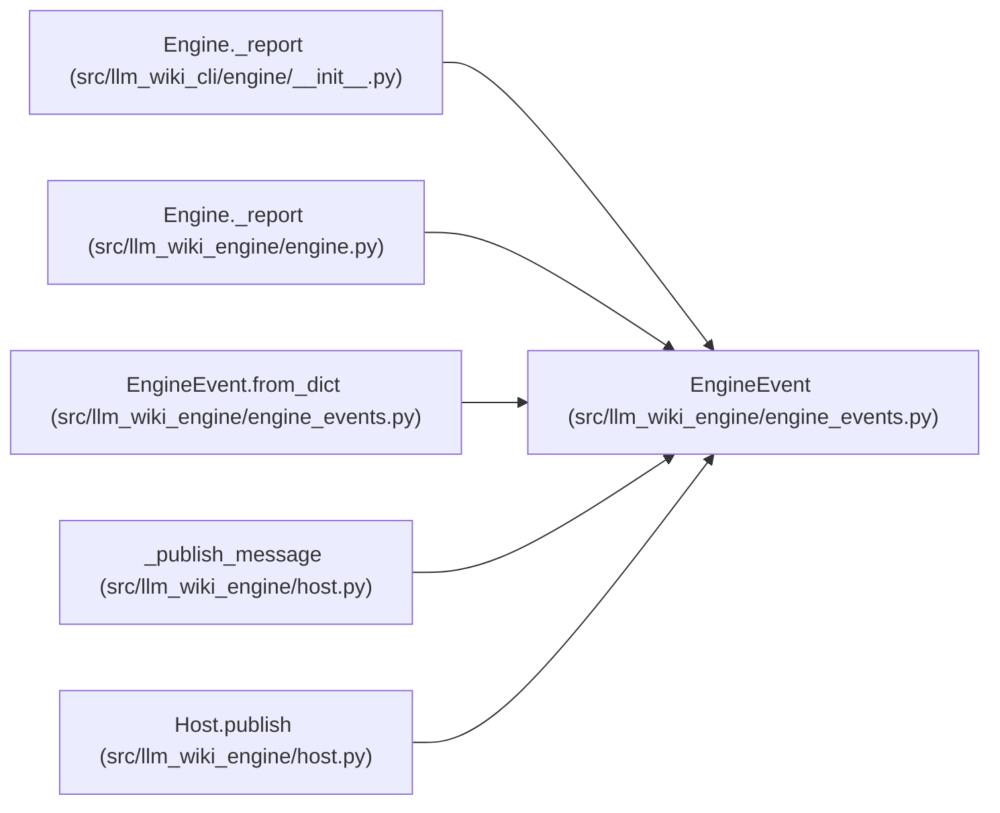

# EngineEvent

**Location:** `src/llm_wiki_engine/engine_events.py:55`
**Kind:** Class
**Bases:** —
**Module:** [engine_events](../modules/engine_events.md)

**Decorators:** `@dataclass(frozen=True)`

## Description

One thing that happened during an engine operation.

## Attributes

| Name | Type | Default | Description |
|------|------|---------|-------------|
| `kind` | `EventKind` | *required* | — |
| `operation` | `str` | *required* | — |
| `operation_id` | `str` | *required* | — |
| `data` | `Mapping[str, Any]` | `field(default_factory=dict)` | — |

## Methods

| Method | Signature | Decorators | Description |
|--------|-----------|------------|-------------|
| `__post_init__` | `() -> None` | — | — |
| `to_dict` | `() -> dict[str, Any]` | — | The ``llm-wiki-engine-event/v1`` form of this event. |
| `from_dict` | `(document: object) -> EngineEvent` | `@classmethod` | Read an event written by :meth:`to_dict`; ``ValueError`` when invalid. |

## Relationships

<!-- Auto-generated relationship summary. Do not edit by hand. -->

### Summary

| Module | Methods | Attributes |
|---|---:|---|
| [engine_events](../modules/engine_events.md) | 3 | `data`, `kind`, `operation`, `operation_id` |

### References

| Reference | Kind | Source | Call sites |
|---|---|---|---:|
| `Engine._report` | call | [engine___init__](../modules/engine___init__.md) | 1 |
| `Engine._report` | call | [engine](../modules/engine.md) | 1 |
| `EngineEvent.from_dict` | call | [engine_events](../modules/engine_events.md) | 1 |
| `EngineEvent.from_dict` | type_reference | [engine_events](../modules/engine_events.md) | — |
| `_publish_message` | call | [host](../modules/host.md) | 1 |
| `Host.publish` | type_reference | [host](../modules/host.md) | — |
