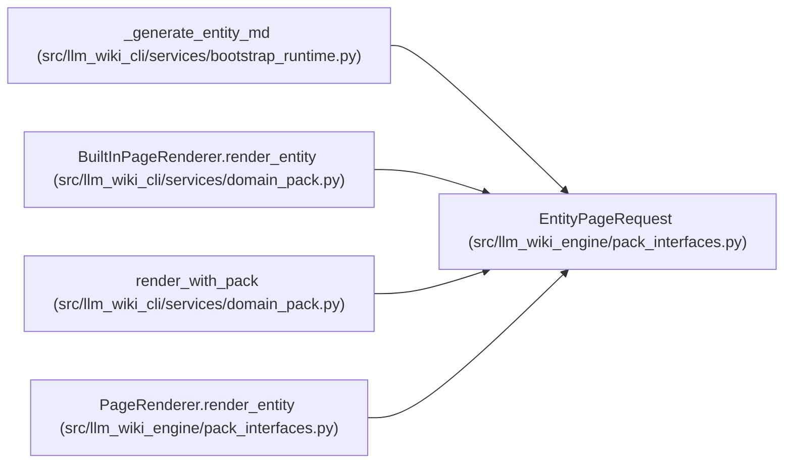

# EntityPageRequest

**Location:** `src/llm_wiki_engine/pack_interfaces.py:91`
**Kind:** Class
**Bases:** —
**Module:** [pack_interfaces](../modules/pack_interfaces.md)

**Decorators:** `@dataclass(frozen=True)`

## Description

Everything a renderer gets for one entity page.

## Attributes

| Name | Type | Default | Description |
|------|------|---------|-------------|
| `entity` | `Mapping[str, Any]` | *required* | — |
| `source_path` | `str` | *required* | — |
| `module_page` | `str \| None` | *required* | — |
| `relationships` | `Mapping[str, Any]` | *required* | — |
| `relationship_summary` | `Mapping[str, Any]` | *required* | — |
| `module_pages` | `Mapping[str, str]` | *required* | — |
| `diagram_style` | `Mapping[str, Any] \| None` | *required* | — |
| `_builtin` | `Callable[[], str]` | `field(repr=False, compare=False)` | — |

## Methods

| Method | Signature | Decorators | Description |
|--------|-----------|------------|-------------|
| `builtin_markdown` | `() -> str` | — | The Markdown the built-in renderer writes for this page. |

## Relationships

<!-- Auto-generated relationship summary. Do not edit by hand. -->

### Summary

| Module | Methods | Attributes |
|---|---:|---|
| [pack_interfaces](../modules/pack_interfaces.md) | 1 | `_builtin`, `diagram_style`, `entity`, `module_page`, `module_pages`, `relationship_summary`, `relationships`, `source_path` |

### References

| Reference | Kind | Source | Call sites |
|---|---|---|---:|
| `_generate_entity_md` | call | [bootstrap_runtime](../modules/bootstrap_runtime.md) | 1 |
| `BuiltInPageRenderer.render_entity` | type_reference | [domain_pack](../modules/domain_pack.md) | — |
| `render_with_pack` | type_reference | [domain_pack](../modules/domain_pack.md) | — |
| `PageRenderer.render_entity` | type_reference | [pack_interfaces](../modules/pack_interfaces.md) | — |
