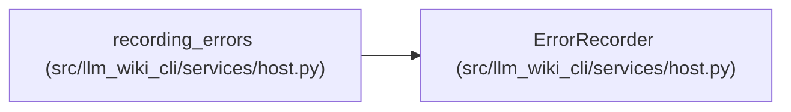

# ErrorRecorder

**Location:** `src/llm_wiki_cli/services/host.py:259`
**Kind:** Class
**Bases:** —
**Module:** [host](../modules/host.md)

## Description

Forwards writes to a host's stderr and keeps a copy for error messages.

## Attributes

*No annotated attributes found.*

## Methods

| Method | Signature | Decorators | Description |
|--------|-----------|------------|-------------|
| `__init__` | `(host: Host) -> None` | — | — |
| `write` | `(text: str, /) -> int` | — | — |
| `flush` | `() -> None` | — | — |
| `error_text` | `() -> str` | — | The ``Error:`` lines written so far, or every line if there are none. |

## Relationships

<!-- Auto-generated relationship summary. Do not edit by hand. -->

### Summary

| Module | Methods | Attributes |
|---|---:|---|
| [host](../modules/host.md) | 4 | — |

### References

| Reference | Kind | Source | Call sites |
|---|---|---|---:|
| `recording_errors` | call | [host](../modules/host.md) | 1 |
| `recording_errors` | type_reference | [host](../modules/host.md) | — |
