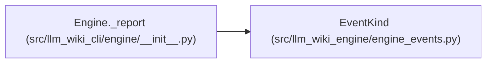

# EventKind

**Location:** `src/llm_wiki_engine/engine_events.py:43`
**Kind:** Type alias
**Bases:** —
**Module:** [engine_events](../modules/engine_events.md)
**Target:** `Literal['operation.started', 'message', 'operation.finished', 'operation.failed']`

## Description

_Auto-generated from `EventKind` in `src/llm_wiki_engine/engine_events.py`._

## Attributes

*See the alias definition for its member types.*

## Methods

*See the alias definition for callable and member types.*

## Relationships

<!-- Auto-generated relationship summary. Do not edit by hand. -->

### Summary

| Module | Methods | Attributes |
|---|---:|---|
| [engine_events](../modules/engine_events.md) | 0 | — |

### References

| Reference | Kind | Source | Call sites |
|---|---|---|---:|
| `Engine._report` | type_reference | [engine___init__](../modules/engine___init__.md) | — |
