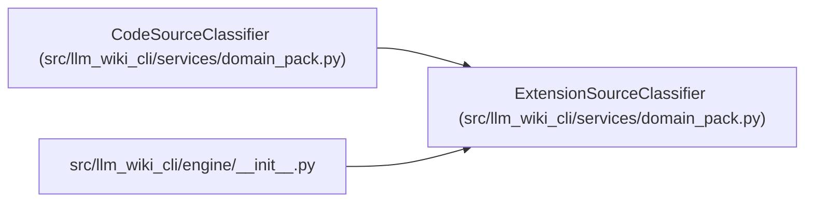

# ExtensionSourceClassifier

**Location:** `src/llm_wiki_cli/services/domain_pack.py:406`
**Kind:** Class
**Bases:** —
**Module:** [domain_pack](../modules/domain_pack.md)

## Description

Classifies sources by file extension, first matching kind wins.

``test_suffixes`` lists, per kind, file-name endings that mark test files;
those are excluded unless the kind is in ``include_tests``.

## Attributes

*No annotated attributes found.*

## Methods

| Method | Signature | Decorators | Description |
|--------|-----------|------------|-------------|
| `__init__` | `(kinds: Mapping[str, Iterable[str]], *, test_suffixes: Mapping[str, Iterable[str]] \| None = None) -> None` | — | — |
| `_kind_table` | `() -> Mapping[str, tuple[str, ...]]` | — | — |
| `source_kinds` | `() -> Mapping[str, tuple[str, ...]]` | — | — |
| `classify` | `(path: PurePath, include_tests: frozenset[str]) -> tuple[str \| None, str \| None]` | — | — |
| `inventory_language` | `(path: str) -> str \| None` | — | — |
| `__repr__` | `() -> str` | — | — |

## Relationships

<!-- Auto-generated relationship summary. Do not edit by hand. -->

### Summary

| Module | Methods | Attributes |
|---|---:|---|
| [domain_pack](../modules/domain_pack.md) | 6 | — |

### Structure

| Kind | Entity | Module |
|---|---|---|
| Subclass | `CodeSourceClassifier` | [domain_pack](../modules/domain_pack.md) |

### References

| Reference | Kind | Source | Call sites |
|---|---|---|---:|
| `__init__` | import | [engine___init__](../modules/engine___init__.md) | — |
