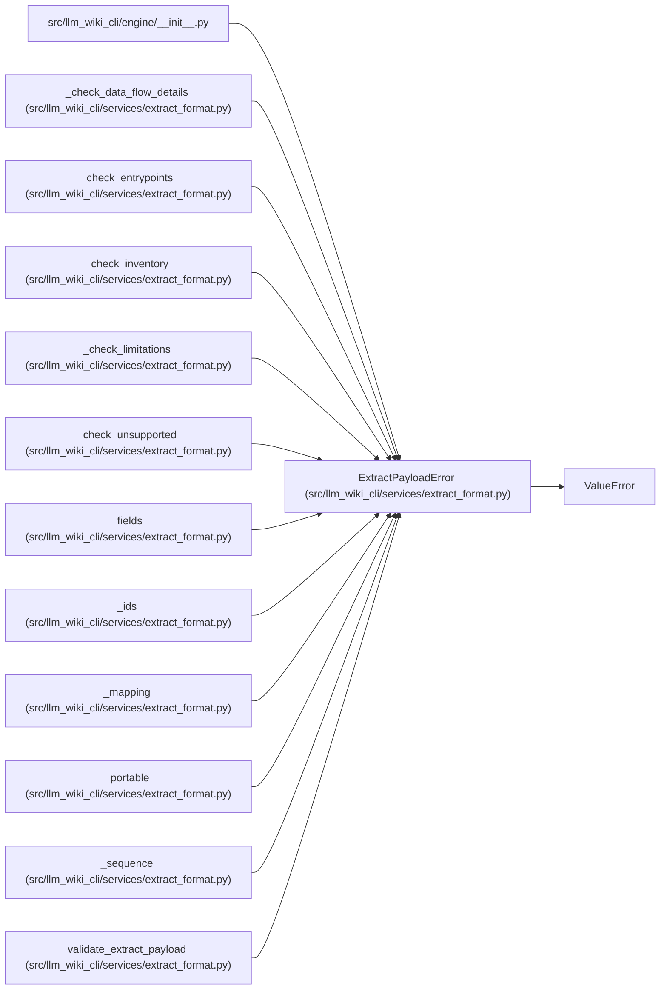

# ExtractPayloadError

**Location:** `src/llm_wiki_cli/services/extract_format.py:102`
**Kind:** Class
**Bases:** `ValueError`
**Module:** [extract_format](../modules/extract_format.md)

## Description

An extract payload does not follow its format.

## Attributes

*No annotated attributes found.*

## Methods

*No declared methods.*

## Relationships

<!-- Auto-generated relationship summary. Do not edit by hand. -->

### Summary

| Module | Methods | Attributes |
|---|---:|---|
| [extract_format](../modules/extract_format.md) | 0 | — |

### Structure

| Kind | Entity | Module |
|---|---|---|
| Base | `ValueError` | — |

### References

| Reference | Kind | Source | Call sites |
|---|---|---|---:|
| `__init__` | import | [engine___init__](../modules/engine___init__.md) | — |
| `_check_data_flow_details` | call | [extract_format](../modules/extract_format.md) | 9 |
| `_check_entrypoints` | call | [extract_format](../modules/extract_format.md) | 2 |
| `_check_inventory` | call | [extract_format](../modules/extract_format.md) | 5 |
| `_check_limitations` | call | [extract_format](../modules/extract_format.md) | 3 |
| `_check_unsupported` | call | [extract_format](../modules/extract_format.md) | 2 |
| `_fields` | call | [extract_format](../modules/extract_format.md) | 3 |
| `_ids` | call | [extract_format](../modules/extract_format.md) | 1 |
| `_mapping` | call | [extract_format](../modules/extract_format.md) | 1 |
| `_portable` | call | [extract_format](../modules/extract_format.md) | 1 |
| `_sequence` | call | [extract_format](../modules/extract_format.md) | 1 |
| `validate_extract_payload` | call | [extract_format](../modules/extract_format.md) | 5 |
