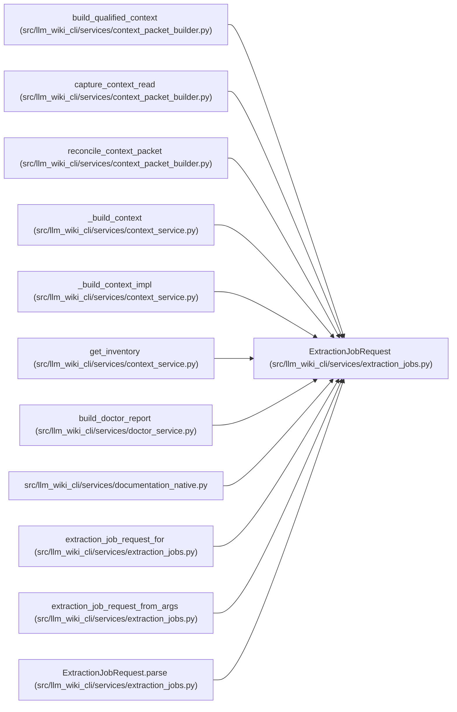

# ExtractionJobRequest

**Location:** `src/llm_wiki_cli/services/extraction_jobs.py:15`
**Kind:** Class
**Bases:** —
**Module:** [extraction_jobs](../modules/extraction_jobs.md)

**Decorators:** `@dataclass(frozen=True)`

## Description

The user-facing extractor job request and its resolved worker limit.

## Attributes

| Name | Type | Default | Description |
|------|------|---------|-------------|
| `requested_jobs` | `RequestedJobs` | *required* | — |
| `resolved_jobs` | `int` | *required* | — |

## Methods

| Method | Signature | Decorators | Description |
|--------|-----------|------------|-------------|
| `parse` | `(value: object) -> 'ExtractionJobRequest'` | `@classmethod` | — |
| `resolved` | `(value: int) -> 'ExtractionJobRequest'` | `@classmethod` | — |

## Relationships

<!-- Auto-generated relationship summary. Do not edit by hand. -->

### Summary

| Module | Methods | Attributes |
|---|---:|---|
| [extraction_jobs](../modules/extraction_jobs.md) | 2 | `requested_jobs`, `resolved_jobs` |

### References

| Reference | Kind | Source | Call sites |
|---|---|---|---:|
| `build_qualified_context` | type_reference | [context_packet_builder](../modules/context_packet_builder.md) | — |
| `capture_context_read` | type_reference | [context_packet_builder](../modules/context_packet_builder.md) | — |
| `reconcile_context_packet` | type_reference | [context_packet_builder](../modules/context_packet_builder.md) | — |
| `_build_context` | type_reference | [context_service](../modules/context_service.md) | — |
| `_build_context_impl` | type_reference | [context_service](../modules/context_service.md) | — |
| `get_inventory` | type_reference | [context_service](../modules/context_service.md) | — |
| `build_doctor_report` | type_reference | [doctor_service](../modules/doctor_service.md) | — |
| `documentation_native` | import | [documentation_native](../modules/documentation_native.md) | — |
| `extraction_job_request_for` | call | [extraction_jobs](../modules/extraction_jobs.md) | 1 |
| `extraction_job_request_for` | type_reference | [extraction_jobs](../modules/extraction_jobs.md) | — |
| `extraction_job_request_from_args` | type_reference | [extraction_jobs](../modules/extraction_jobs.md) | — |
| `ExtractionJobRequest.parse` | call | [extraction_jobs](../modules/extraction_jobs.md) | 2 |

> References: showing 12 of 19 logical references; 7 omitted by the 12-row generated summary limit.
