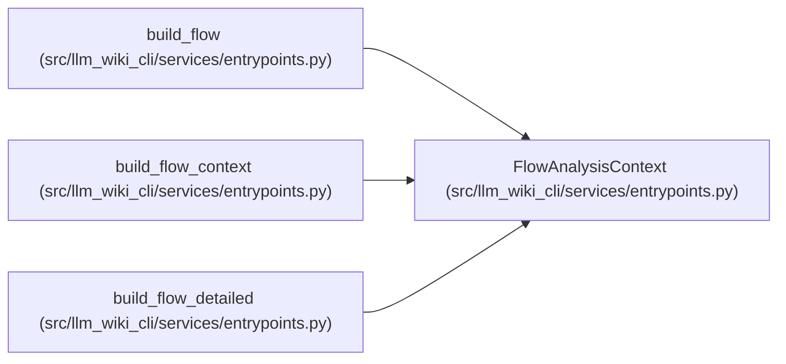

# FlowAnalysisContext

**Location:** `src/llm_wiki_cli/services/entrypoints.py:1201`
**Kind:** Class
**Bases:** —
**Module:** [entrypoints](../modules/entrypoints.md)

**Decorators:** `@dataclass(frozen=True)`

## Description

Read-only adjacency indexes for flows over one caller-owned edge list.

## Attributes

| Name | Type | Default | Description |
|------|------|---------|-------------|
| `adjacency` | `Mapping[tuple, tuple[dict, ...]]` | *required* | — |

## Methods

*No declared methods.*

## Relationships

<!-- Auto-generated relationship summary. Do not edit by hand. -->

### Summary

| Module | Methods | Attributes |
|---|---:|---|
| [entrypoints](../modules/entrypoints.md) | 0 | `adjacency` |

### References

| Reference | Kind | Source | Call sites |
|---|---|---|---:|
| `build_flow` | type_reference | [entrypoints](../modules/entrypoints.md) | — |
| `build_flow_context` | call | [entrypoints](../modules/entrypoints.md) | 1 |
| `build_flow_context` | type_reference | [entrypoints](../modules/entrypoints.md) | — |
| `build_flow_detailed` | type_reference | [entrypoints](../modules/entrypoints.md) | — |
