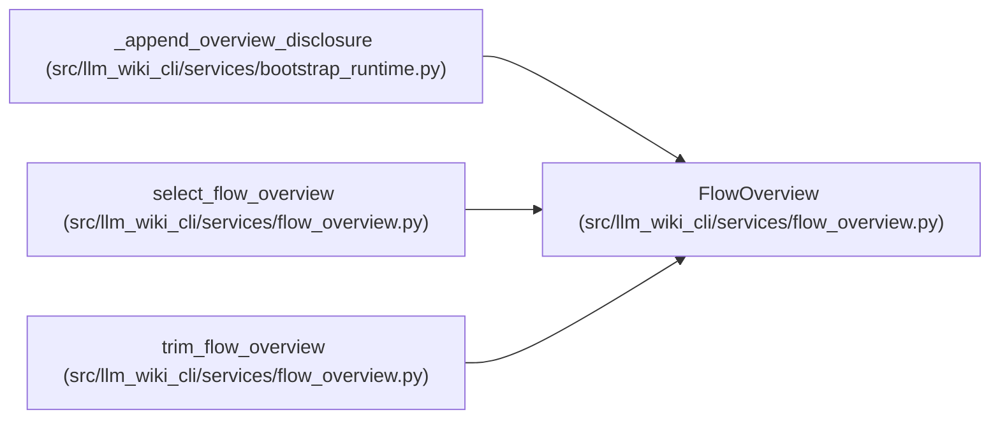

# FlowOverview

**Location:** `src/llm_wiki_cli/services/flow_overview.py:21`
**Kind:** Class
**Bases:** —
**Module:** [flow_overview](../modules/flow_overview.md)

**Decorators:** `@dataclass(frozen=True)`

## Description

Original occurrence evidence and its separate presentation selection.

## Attributes

| Name | Type | Default | Description |
|------|------|---------|-------------|
| `records` | `tuple[Mapping[str, Any], ...]` | *required* | — |
| `selected_step_indexes` | `tuple[int, ...]` | *required* | — |
| `limit` | `int` | *required* | — |
| `upstream_coverage` | `Mapping[str, Any] \| None` | *required* | — |
| `upstream_truncated` | `bool` | *required* | — |

## Methods

| Method | Signature | Decorators | Description |
|--------|-----------|------------|-------------|
| `__post_init__` | `()` | — | — |
| `interactions` | `() -> tuple[Mapping[str, Any], ...]` | `@property` | — |
| `counts` | `() -> dict[str, Any]` | `@property` | — |
| `omission_groups` | `() -> tuple[Mapping[str, Any], ...]` | `@property` | Neutral counts, not fabricated aggregate invocations. |

## Relationships

<!-- Auto-generated relationship summary. Do not edit by hand. -->

### Summary

| Module | Methods | Attributes |
|---|---:|---|
| [flow_overview](../modules/flow_overview.md) | 4 | `limit`, `records`, `selected_step_indexes`, `upstream_coverage`, `upstream_truncated` |

### References

| Reference | Kind | Source | Call sites |
|---|---|---|---:|
| `_append_overview_disclosure` | type_reference | [bootstrap_runtime](../modules/bootstrap_runtime.md) | — |
| `select_flow_overview` | call | [flow_overview](../modules/flow_overview.md) | 1 |
| `select_flow_overview` | type_reference | [flow_overview](../modules/flow_overview.md) | — |
| `trim_flow_overview` | call | [flow_overview](../modules/flow_overview.md) | 1 |
| `trim_flow_overview` | type_reference | [flow_overview](../modules/flow_overview.md) | — |
