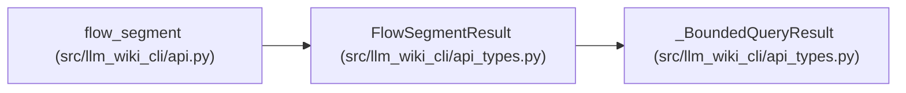

# FlowSegmentResult

**Location:** `src/llm_wiki_cli/api_types.py:360`
**Kind:** Class
**Bases:** `_BoundedQueryResult`
**Module:** [api_types](../modules/api_types.md)

## Description

Additive source-bound static segment; absent coverage means unavailable.

## Attributes

| Name | Type | Presence | Description |
|------|------|----------|-------------|
| `segment_schema` | `str` | *optional* | — |
| `owner` | `dict[str, Any] \| None` | *optional* | — |
| `basis` | `str \| None` | *optional* | — |
| `steps` | `list[dict[str, Any]]` | *optional* | — |
| `coverage` | `dict[str, Any]` | *optional* | — |
| `work` | `dict[str, Any]` | *optional* | — |
| `follow_up` | `dict[str, Any]` | *optional* | — |
| `limitations` | `list[str]` | *optional* | — |

## Methods

*No public methods. Inherits from base classes.*

## Relationships

<!-- Auto-generated relationship summary. Do not edit by hand. -->

### Summary

| Module | Methods | Attributes |
|---|---:|---|
| [api_types](../modules/api_types.md) | 0 | `basis`, `coverage`, `follow_up`, `limitations`, `owner`, `segment_schema`, `steps`, `work` |

### Structure

| Kind | Entity | Module |
|---|---|---|
| Base | `_BoundedQueryResult` | [api_types](../modules/api_types.md) |

### References

| Reference | Kind | Source | Call sites |
|---|---|---|---:|
| `flow_segment` | type_reference | [api](../modules/api.md) | — |
