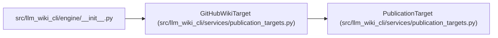

# GitHubWikiTarget

**Location:** `src/llm_wiki_cli/services/publication_targets.py:80`
**Kind:** Class
**Bases:** `PublicationTarget`
**Module:** [publication_targets](../modules/publication_targets.md)

## Description

A GitHub wiki: flat Markdown pages, ``Home.md`` required, ``owner/repo`` names.

## Attributes

*No annotated attributes found.*

## Methods

| Method | Signature | Decorators | Description |
|--------|-----------|------------|-------------|
| `check_repository` | `(value: object, field: str) -> str` | — | — |
| `prepare_page` | `(markdown: str, *, source_path: str, source_pages: Mapping[str, str], source_assets: Mapping[str, str], repository_url: str \| None, source_revision: str \| None) -> str` | — | — |
| `check` | `(files: Mapping[str, bytes]) -> dict[str, Any]` | — | — |

## Relationships

<!-- Auto-generated relationship summary. Do not edit by hand. -->

### Summary

| Module | Methods | Attributes |
|---|---:|---|
| [publication_targets](../modules/publication_targets.md) | 3 | — |

### Structure

| Kind | Entity | Module |
|---|---|---|
| Base | `PublicationTarget` | [publication_targets](../modules/publication_targets.md) |

### References

| Reference | Kind | Source | Call sites |
|---|---|---|---:|
| `__init__` | import | [engine___init__](../modules/engine___init__.md) | — |
