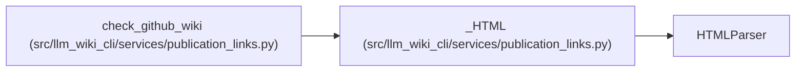

# _HTML

**Location:** `src/llm_wiki_cli/services/publication_links.py:516`
**Kind:** Class
**Bases:** `HTMLParser`
**Module:** [publication_links](../modules/publication_links.md)

## Description

_Auto-generated from `_HTML` in `src/llm_wiki_cli/services/publication_links.py`._

## Attributes

*No annotated attributes found.*

## Methods

| Method | Signature | Decorators | Description |
|--------|-----------|------------|-------------|
| `__init__` | `()` | — | — |
| `handle_starttag` | `(tag, attrs)` | — | — |
| `handle_startendtag` | `(tag, attrs)` | — | — |
| `unknown_decl` | `(data)` | — | — |

## Relationships

<!-- Auto-generated relationship summary. Do not edit by hand. -->

### Summary

| Module | Methods | Attributes |
|---|---:|---|
| [publication_links](../modules/publication_links.md) | 4 | — |

### Structure

| Kind | Entity | Module |
|---|---|---|
| Base | `HTMLParser` | — |

### References

| Reference | Kind | Source | Call sites |
|---|---|---|---:|
| `check_github_wiki` | call | [publication_links](../modules/publication_links.md) | 1 |
