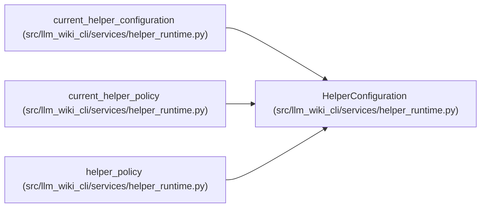

# HelperConfiguration

**Location:** `src/llm_wiki_cli/services/helper_runtime.py:89`
**Kind:** Class
**Bases:** —
**Module:** [helper_runtime](../modules/helper_runtime.md)

**Decorators:** `@dataclass(frozen=True)`

## Description

_Auto-generated from `HelperConfiguration` in `src/llm_wiki_cli/services/helper_runtime.py`._

## Attributes

| Name | Type | Default | Description |
|------|------|---------|-------------|
| `policy` | `HelperPolicy` | *required* | — |
| `cache_dir` | `str \| None` | `None` | — |
| `progress` | `HelperProgress \| None` | `field(default=None, repr=False, compare=False)` | — |

## Methods

*No declared methods.*

## Relationships

<!-- Auto-generated relationship summary. Do not edit by hand. -->

### Summary

| Module | Methods | Attributes |
|---|---:|---|
| [helper_runtime](../modules/helper_runtime.md) | 0 | `cache_dir`, `policy`, `progress` |

### References

| Reference | Kind | Source | Call sites |
|---|---|---|---:|
| `current_helper_configuration` | type_reference | [helper_runtime](../modules/helper_runtime.md) | — |
| `current_helper_policy` | type_reference | [helper_runtime](../modules/helper_runtime.md) | — |
| `helper_policy` | call | [helper_runtime](../modules/helper_runtime.md) | 1 |
| `helper_policy` | type_reference | [helper_runtime](../modules/helper_runtime.md) | — |
