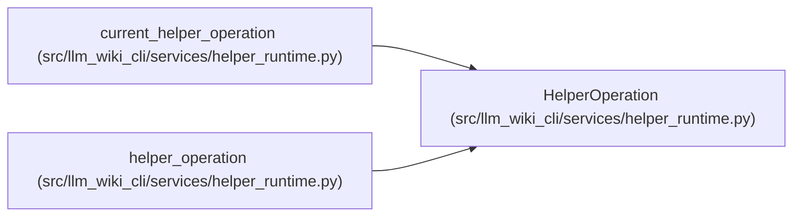

# HelperOperation

**Location:** `src/llm_wiki_cli/services/helper_runtime.py:96`
**Kind:** Class
**Bases:** —
**Module:** [helper_runtime](../modules/helper_runtime.md)

**Decorators:** `@dataclass(frozen=True)`

## Description

_Auto-generated from `HelperOperation` in `src/llm_wiki_cli/services/helper_runtime.py`._

## Attributes

| Name | Type | Default | Description |
|------|------|---------|-------------|
| `policy` | `HelperPolicy` | *required* | — |
| `cache_dir` | `str \| None` | `None` | — |
| `progress` | `HelperProgress \| None` | `field(default=None, repr=False, compare=False)` | — |
| `_configuration` | `HelperConfiguration \| None` | `field(default=None, repr=False, compare=False)` | — |
| `_handles` | `dict[str, PreparedHelperHandle]` | `field(default_factory=dict, repr=False, compare=False)` | — |
| `_source_roots` | `dict[tuple[Path, str], Path]` | `field(default_factory=dict, repr=False, compare=False)` | — |
| `_missing` | `dict[tuple[Path, str], tuple[Path, ...]]` | `field(default_factory=dict, repr=False, compare=False)` | — |

## Methods

| Method | Signature | Decorators | Description |
|--------|-----------|------------|-------------|
| `missing_scope` | `(source_root: str \| Path, language: str) -> tuple[Path, ...] \| None` | — | — |
| `bind_missing` | `(language: str, source_root: str \| Path, roots: tuple[Path, ...]) -> None` | — | Keep a selected strict miss stable if a concurrent build publishes later. |
| `handles` | `() -> Mapping[str, PreparedHelperHandle]` | `@property` | — |
| `bind` | `(handle: PreparedHelperHandle, *, source_root: str \| Path \| None = None) -> None` | — | — |

## Relationships

<!-- Auto-generated relationship summary. Do not edit by hand. -->

### Summary

| Module | Methods | Attributes |
|---|---:|---|
| [helper_runtime](../modules/helper_runtime.md) | 4 | `_configuration`, `_handles`, `_missing`, `_source_roots`, `cache_dir`, `policy`, `progress` |

### References

| Reference | Kind | Source | Call sites |
|---|---|---|---:|
| `current_helper_operation` | type_reference | [helper_runtime](../modules/helper_runtime.md) | — |
| `helper_operation` | call | [helper_runtime](../modules/helper_runtime.md) | 1 |
| `helper_operation` | type_reference | [helper_runtime](../modules/helper_runtime.md) | — |
