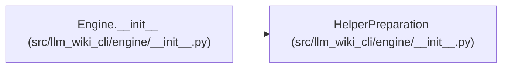

# HelperPreparation

**Location:** `src/llm_wiki_cli/engine/__init__.py:238`
**Kind:** Type alias
**Bases:** —
**Module:** [engine___init__](../modules/engine___init__.md)
**Target:** `Literal['auto', 'never']`

## Description

_Auto-generated from `HelperPreparation` in `src/llm_wiki_cli/engine/__init__.py`._

## Attributes

*See the alias definition for its member types.*

## Methods

*See the alias definition for callable and member types.*

## Relationships

<!-- Auto-generated relationship summary. Do not edit by hand. -->

### Summary

| Module | Methods | Attributes |
|---|---:|---|
| [engine___init__](../modules/engine___init__.md) | 0 | — |

### References

| Reference | Kind | Source | Call sites |
|---|---|---|---:|
| `Engine.__init__` | type_reference | [engine___init__](../modules/engine___init__.md) | — |
