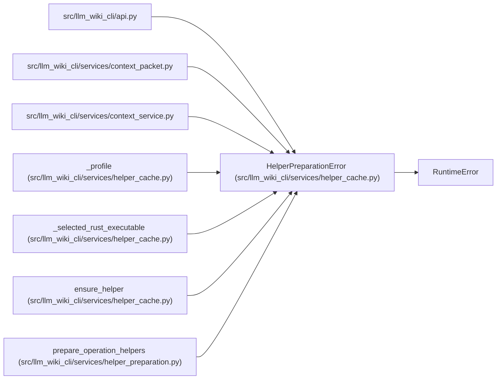

# HelperPreparationError

**Location:** `src/llm_wiki_cli/services/helper_cache.py:47`
**Kind:** Class
**Bases:** `RuntimeError`
**Module:** [helper_cache](../modules/helper_cache.md)

## Description

The selected bundled helper could not be prepared once.

## Attributes

*No annotated attributes found.*

## Methods

| Method | Signature | Decorators | Description |
|--------|-----------|------------|-------------|
| `__init__` | `(language: str, message: str, cache_root: Path \| None = None)` | — | — |
| `__str__` | `() -> str` | — | — |

## Relationships

<!-- Auto-generated relationship summary. Do not edit by hand. -->

### Summary

| Module | Methods | Attributes |
|---|---:|---|
| [helper_cache](../modules/helper_cache.md) | 2 | — |

### Structure

| Kind | Entity | Module |
|---|---|---|
| Base | `RuntimeError` | — |

### References

| Reference | Kind | Source | Call sites |
|---|---|---|---:|
| `api` | import | [api](../modules/api.md) | — |
| `context_packet` | import | [context_packet](../modules/context_packet.md) | — |
| `context_service` | import | [context_service](../modules/context_service.md) | — |
| `_profile` | call | [helper_cache](../modules/helper_cache.md) | 12 |
| `_selected_rust_executable` | call | [helper_cache](../modules/helper_cache.md) | 3 |
| `ensure_helper` | call | [helper_cache](../modules/helper_cache.md) | 2 |
| `prepare_operation_helpers` | call | [helper_preparation](../modules/helper_preparation.md) | 3 |
