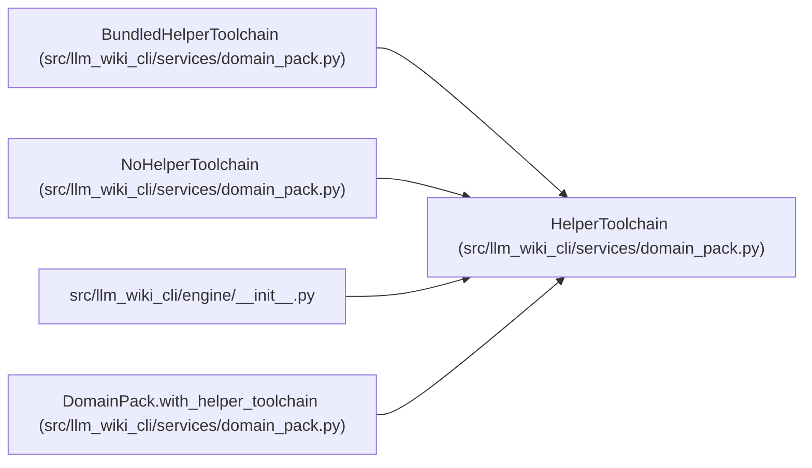

# HelperToolchain

**Location:** `src/llm_wiki_cli/services/domain_pack.py:655`
**Kind:** Class
**Bases:** —
**Module:** [domain_pack](../modules/domain_pack.md)

## Description

Which analysis helpers a source tree needs, and how they are prepared.

:meth:`languages` lists the source kinds whose extraction needs a
prepared helper. :meth:`prepare` runs before extraction inside a helper
operation: it resolves each needed helper under the operation's policy
(``"never"`` only reuses prepared artifacts, ``"auto"`` may build them),
binds what it found to the operation and returns those handles.

## Attributes

*No annotated attributes found.*

## Methods

| Method | Signature | Decorators | Description |
|--------|-----------|------------|-------------|
| `languages` | `(snapshot: SourceSnapshot, registry: Mapping[str, str], *, only_files: Iterable[str] \| None = None) -> tuple[str, ...]` | — | — |
| `prepare` | `(snapshot: SourceSnapshot, registry: Mapping[str, str], *, only_files: Iterable[str] \| None = None, cache_dir: str \| None = None) -> tuple[PreparedHelperHandle, ...]` | — | — |
| `__repr__` | `() -> str` | — | — |

## Relationships

<!-- Auto-generated relationship summary. Do not edit by hand. -->

### Summary

| Module | Methods | Attributes |
|---|---:|---|
| [domain_pack](../modules/domain_pack.md) | 3 | — |

### Structure

| Kind | Entity | Module |
|---|---|---|
| Subclass | `BundledHelperToolchain` | [domain_pack](../modules/domain_pack.md) |
| Subclass | `NoHelperToolchain` | [domain_pack](../modules/domain_pack.md) |

### References

| Reference | Kind | Source | Call sites |
|---|---|---|---:|
| `__init__` | import | [engine___init__](../modules/engine___init__.md) | — |
| `DomainPack.with_helper_toolchain` | type_reference | [domain_pack](../modules/domain_pack.md) | — |
