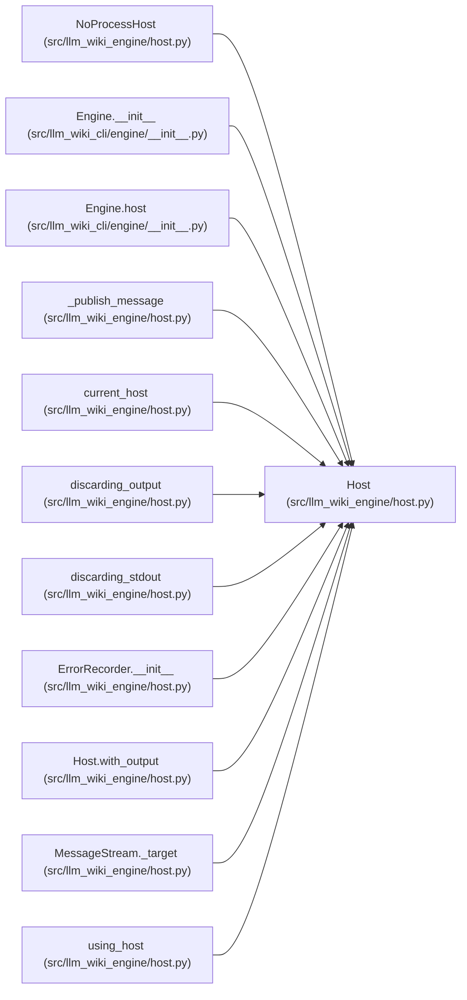

# Host

**Location:** `src/llm_wiki_engine/host.py:63`
**Kind:** Class
**Bases:** —
**Module:** [host](../modules/host.md)

## Description

This machine: real processes, live environment and cwd, wall clock.

## Attributes

| Name | Type | Default | Description |
|------|------|---------|-------------|
| `capabilities` | `frozenset[str]` | `ALL_CAPABILITIES` | — |
| `_stdout` | `TextSink \| None` | `None` | — |
| `_stderr` | `TextSink \| None` | `None` | — |
| `_events` | `EventSink \| None` | `None` | — |

## Methods

| Method | Signature | Decorators | Description |
|--------|-----------|------------|-------------|
| `__init__` | `(*, stdout: TextSink \| None = None, stderr: TextSink \| None = None, events: EventSink \| None = None) -> None` | — | — |
| `stdout` | `() -> TextSink` | `@property` | Where progress and results are written. |
| `stderr` | `() -> TextSink` | `@property` | Where warnings and errors are written. |
| `reports_events` | `() -> bool` | `@property` | Whether this host receives structured engine events. |
| `publish` | `(event: EngineEvent) -> None` | — | Hand one engine event to this host's event sink, if it has one. |
| `with_output` | `(*, stdout: TextSink \| None = None, stderr: TextSink \| None = None) -> Host` | — | A copy of this host whose given streams replace the current ones. |
| `run` | `(args: Any, **options: Any) -> subprocess.CompletedProcess` | — | — |
| `popen` | `(args: Any, **options: Any) -> subprocess.Popen` | — | — |
| `environ` | `() -> Mapping[str, str]` | `@property` | — |
| `cwd` | `() -> Path` | — | — |
| `now` | `() -> datetime` | — | The current UTC time. |
| `today` | `() -> date` | — | The local calendar date. |

## Relationships

<!-- Auto-generated relationship summary. Do not edit by hand. -->

### Summary

| Module | Methods | Attributes |
|---|---:|---|
| [host](../modules/host.md) | 12 | `_events`, `_stderr`, `_stdout`, `capabilities` |

### Structure

| Kind | Entity | Module |
|---|---|---|
| Subclass | `NoProcessHost` | [host](../modules/host.md) |

### References

| Reference | Kind | Source | Call sites |
|---|---|---|---:|
| `Engine.__init__` | call | [engine___init__](../modules/engine___init__.md) | 1 |
| `Engine.__init__` | type_reference | [engine___init__](../modules/engine___init__.md) | — |
| `Engine.host` | type_reference | [engine___init__](../modules/engine___init__.md) | — |
| `_publish_message` | type_reference | [host](../modules/host.md) | — |
| `current_host` | type_reference | [host](../modules/host.md) | — |
| `discarding_output` | type_reference | [host](../modules/host.md) | — |
| `discarding_stdout` | type_reference | [host](../modules/host.md) | — |
| `ErrorRecorder.__init__` | type_reference | [host](../modules/host.md) | — |
| `Host.with_output` | type_reference | [host](../modules/host.md) | — |
| `MessageStream._target` | type_reference | [host](../modules/host.md) | — |
| `using_host` | type_reference | [host](../modules/host.md) | — |
