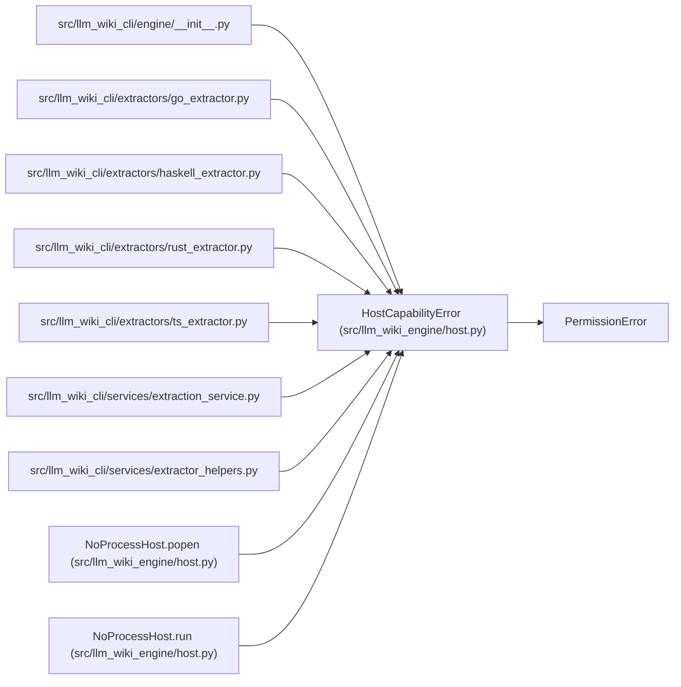

# HostCapabilityError

**Location:** `src/llm_wiki_engine/host.py:52`
**Kind:** Class
**Bases:** `PermissionError`
**Module:** [host](../modules/host.md)

## Description

The active host does not grant this capability.

It is an ``OSError``, so callers that already treat an unavailable
executable as a soft failure degrade the same way.

## Attributes

*No annotated attributes found.*

## Methods

*No declared methods.*

## Relationships

<!-- Auto-generated relationship summary. Do not edit by hand. -->

### Summary

| Module | Methods | Attributes |
|---|---:|---|
| [host](../modules/host.md) | 0 | — |

### Structure

| Kind | Entity | Module |
|---|---|---|
| Base | `PermissionError` | — |

### References

| Reference | Kind | Source | Call sites |
|---|---|---|---:|
| `__init__` | import | [engine___init__](../modules/engine___init__.md) | — |
| `go_extractor` | import | [go_extractor](../modules/go_extractor.md) | — |
| `haskell_extractor` | import | [haskell_extractor](../modules/haskell_extractor.md) | — |
| `rust_extractor` | import | [rust_extractor](../modules/rust_extractor.md) | — |
| `ts_extractor` | import | [ts_extractor](../modules/ts_extractor.md) | — |
| `extraction_service` | import | [extraction_service](../modules/extraction_service.md) | — |
| `extractor_helpers` | import | [extractor_helpers](../modules/extractor_helpers.md) | — |
| `NoProcessHost.popen` | call | [host](../modules/host.md) | 1 |
| `NoProcessHost.run` | call | [host](../modules/host.md) | 1 |
