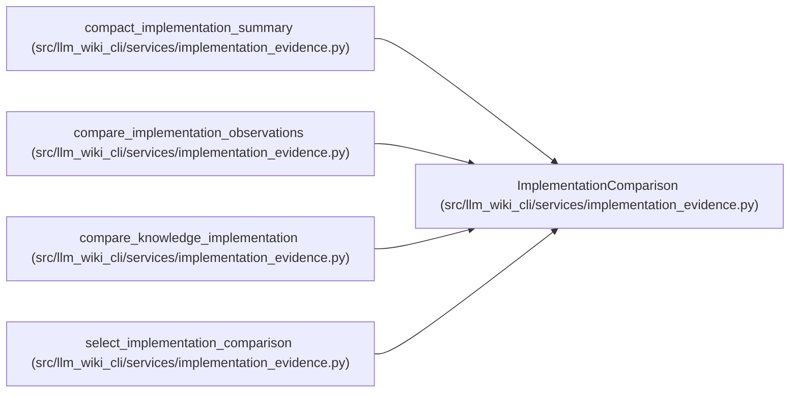

# ImplementationComparison

**Location:** `src/llm_wiki_cli/services/implementation_evidence.py:714`
**Kind:** Class
**Bases:** —
**Module:** [implementation_evidence](../modules/implementation_evidence.md)

**Decorators:** `@dataclass(frozen=True)`

## Description

_Auto-generated from `ImplementationComparison` in `src/llm_wiki_cli/services/implementation_evidence.py`._

## Attributes

| Name | Type | Default | Description |
|------|------|---------|-------------|
| `state` | `str` | *required* | — |
| `reason` | `str` | *required* | — |
| `coordinate` | `Mapping \| None` | `None` | — |
| `scope` | `str \| None` | `None` | — |
| `analysis_scope` | `str` | `'snapshot'` | — |
| `live_comparison_performed` | `bool` | `False` | — |
| `source_changed` | `bool \| None` | `None` | — |
| `documentation_changed` | `bool \| None` | `None` | — |
| `recorded` | `Mapping \| None` | `None` | — |
| `live` | `Mapping \| None` | `None` | — |
| `truncated` | `bool` | `False` | — |
| `limitations` | `tuple[str, ...]` | `LIMITATIONS` | — |

## Methods

| Method | Signature | Decorators | Description |
|--------|-----------|------------|-------------|
| `__post_init__` | `()` | — | — |
| `to_payload` | `() -> dict` | — | — |

## Relationships

<!-- Auto-generated relationship summary. Do not edit by hand. -->

### Summary

| Module | Methods | Attributes |
|---|---:|---|
| [implementation_evidence](../modules/implementation_evidence.md) | 2 | `analysis_scope`, `coordinate`, `documentation_changed`, `limitations`, `live`, `live_comparison_performed`, `reason`, `recorded`, `scope`, `source_changed`, `state`, `truncated` |

### References

| Reference | Kind | Source | Call sites |
|---|---|---|---:|
| `compact_implementation_summary` | type_reference | [implementation_evidence](../modules/implementation_evidence.md) | — |
| `compare_implementation_observations` | call | [implementation_evidence](../modules/implementation_evidence.md) | 1 |
| `compare_implementation_observations` | type_reference | [implementation_evidence](../modules/implementation_evidence.md) | — |
| `compare_knowledge_implementation` | call | [implementation_evidence](../modules/implementation_evidence.md) | 4 |
| `select_implementation_comparison` | call | [implementation_evidence](../modules/implementation_evidence.md) | 2 |
| `select_implementation_comparison` | type_reference | [implementation_evidence](../modules/implementation_evidence.md) | — |
