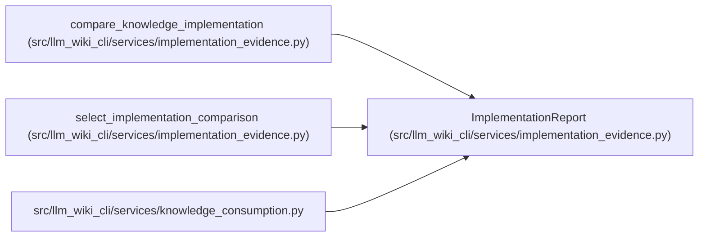

# ImplementationReport

**Location:** `src/llm_wiki_cli/services/implementation_evidence.py:739`
**Kind:** Class
**Bases:** —
**Module:** [implementation_evidence](../modules/implementation_evidence.md)

**Decorators:** `@dataclass(frozen=True)`

## Description

_Auto-generated from `ImplementationReport` in `src/llm_wiki_cli/services/implementation_evidence.py`._

## Attributes

| Name | Type | Default | Description |
|------|------|---------|-------------|
| `by_locator` | `Mapping[str, ImplementationComparison]` | *required* | — |
| `by_coordinate` | `Mapping[str, ImplementationComparison]` | *required* | — |
| `analysis_scope` | `str` | `'snapshot'` | — |

## Methods

| Method | Signature | Decorators | Description |
|--------|-----------|------------|-------------|
| `__post_init__` | `()` | — | — |
| `to_payload` | `() -> dict` | — | — |

## Relationships

<!-- Auto-generated relationship summary. Do not edit by hand. -->

### Summary

| Module | Methods | Attributes |
|---|---:|---|
| [implementation_evidence](../modules/implementation_evidence.md) | 2 | `analysis_scope`, `by_coordinate`, `by_locator` |

### References

| Reference | Kind | Source | Call sites |
|---|---|---|---:|
| `compare_knowledge_implementation` | call | [implementation_evidence](../modules/implementation_evidence.md) | 1 |
| `compare_knowledge_implementation` | type_reference | [implementation_evidence](../modules/implementation_evidence.md) | — |
| `select_implementation_comparison` | type_reference | [implementation_evidence](../modules/implementation_evidence.md) | — |
| `knowledge_consumption` | import | [knowledge_consumption](../modules/knowledge_consumption.md) | — |
