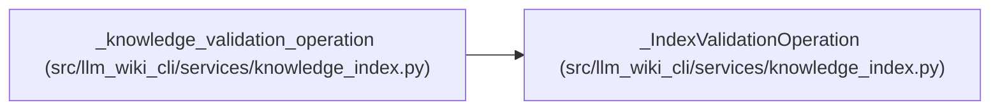

# _IndexValidationOperation

**Location:** `src/llm_wiki_cli/services/knowledge_index.py:315`
**Kind:** Class
**Bases:** —
**Module:** [knowledge_index](../modules/knowledge_index.md)

**Decorators:** `@dataclass(frozen=True)`

## Description

_Auto-generated from `_IndexValidationOperation` in `src/llm_wiki_cli/services/knowledge_index.py`._

## Attributes

| Name | Type | Default | Description |
|------|------|---------|-------------|
| `wiki_root` | `Path` | *required* | — |
| `token` | `object` | `field(default_factory=object)` | — |
| `_active` | `bool` | `field(default=True, init=False, repr=False, compare=False)` | — |
| `models` | `dict` | `field(default_factory=dict, init=False, repr=False, compare=False)` | — |

## Methods

*No public methods. Inherits from base classes.*

## Relationships

<!-- Auto-generated relationship summary. Do not edit by hand. -->

### Summary

| Module | Methods | Attributes |
|---|---:|---|
| [knowledge_index](../modules/knowledge_index.md) | 0 | `_active`, `models`, `token`, `wiki_root` |

### References

| Reference | Kind | Source | Call sites |
|---|---|---|---:|
| `_knowledge_validation_operation` | call | [knowledge_index](../modules/knowledge_index.md) | 1 |
