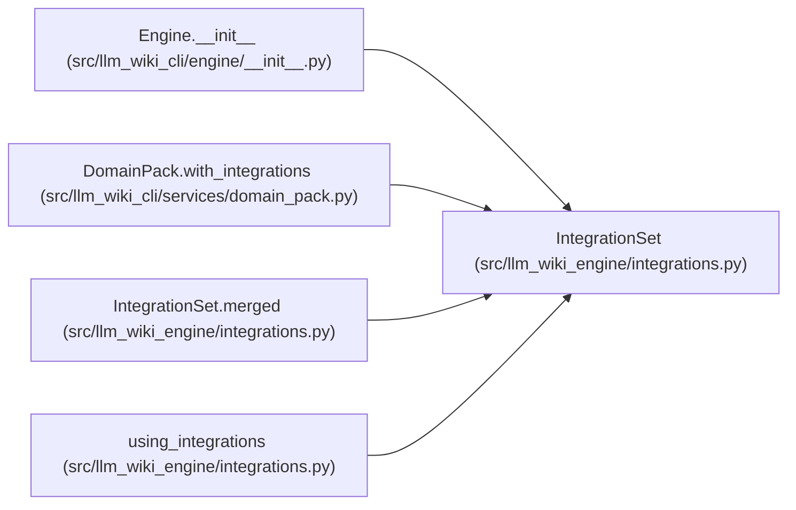

# IntegrationSet

**Location:** `src/llm_wiki_engine/integrations.py:71`
**Kind:** Class
**Bases:** —
**Module:** [integrations](../modules/integrations.md)

## Description

Provider modules for some capabilities, used inside one scope.

``inherit`` decides what an unnamed capability resolves to inside the
scope: the process-wide default (``True``) or nothing (``False``).

## Attributes

*No annotated attributes found.*

## Methods

| Method | Signature | Decorators | Description |
|--------|-----------|------------|-------------|
| `__init__` | `(modules: Mapping[str, str] \| None = None, *, inherit: bool = True) -> None` | — | — |
| `modules` | `() -> Mapping[str, str]` | `@property` | The provider module named for each capability in this set. |
| `inherit` | `() -> bool` | `@property` | Whether unnamed capabilities fall back to the process-wide defaults. |
| `merged` | `(override: IntegrationSet) -> IntegrationSet` | — | This set with ``override``'s providers on top. |
| `describe` | `() -> dict[str, object]` | — | A JSON-ready summary of the set. |
| `__eq__` | `(other: object) -> bool` | — | — |
| `__hash__` | `() -> int` | — | — |
| `__repr__` | `() -> str` | — | — |

## Relationships

<!-- Auto-generated relationship summary. Do not edit by hand. -->

### Summary

| Module | Methods | Attributes |
|---|---:|---|
| [integrations](../modules/integrations.md) | 8 | — |

### References

| Reference | Kind | Source | Call sites |
|---|---|---|---:|
| `Engine.__init__` | type_reference | [engine___init__](../modules/engine___init__.md) | — |
| `DomainPack.with_integrations` | type_reference | [domain_pack](../modules/domain_pack.md) | — |
| `IntegrationSet.merged` | call | [integrations](../modules/integrations.md) | 1 |
| `IntegrationSet.merged` | type_reference | [integrations](../modules/integrations.md) | — |
| `using_integrations` | type_reference | [integrations](../modules/integrations.md) | — |
