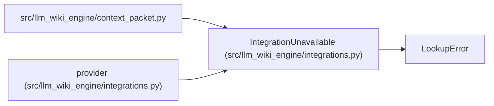

# IntegrationUnavailable

**Location:** `src/llm_wiki_engine/integrations.py:64`
**Kind:** Class
**Bases:** `LookupError`
**Module:** [integrations](../modules/integrations.md)

## Description

The application did not provide a capability the knowledge core needs.

## Attributes

*No annotated attributes found.*

## Methods

*No declared methods.*

## Relationships

<!-- Auto-generated relationship summary. Do not edit by hand. -->

### Summary

| Module | Methods | Attributes |
|---|---:|---|
| [integrations](../modules/integrations.md) | 0 | — |

### Structure

| Kind | Entity | Module |
|---|---|---|
| Base | `LookupError` | — |

### References

| Reference | Kind | Source | Call sites |
|---|---|---|---:|
| `context_packet` | import | [context_packet](../modules/context_packet.md) | — |
| `provider` | call | [integrations](../modules/integrations.md) | 1 |
