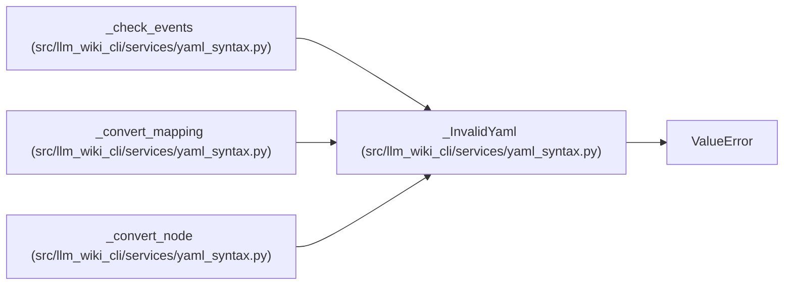

# _InvalidYaml

**Location:** `src/llm_wiki_cli/services/yaml_syntax.py:26`
**Kind:** Class
**Bases:** `ValueError`
**Module:** [yaml_syntax](../modules/yaml_syntax.md)

## Description

An unsupported or over-budget YAML observation.

## Attributes

*No annotated attributes found.*

## Methods

*No public methods. Inherits from base classes.*

## Relationships

<!-- Auto-generated relationship summary. Do not edit by hand. -->

### Summary

| Module | Methods | Attributes |
|---|---:|---|
| [yaml_syntax](../modules/yaml_syntax.md) | 0 | — |

### Structure

| Kind | Entity | Module |
|---|---|---|
| Base | `ValueError` | — |

### References

| Reference | Kind | Source | Call sites |
|---|---|---|---:|
| `_check_events` | call | [yaml_syntax](../modules/yaml_syntax.md) | 3 |
| `_convert_mapping` | call | [yaml_syntax](../modules/yaml_syntax.md) | 5 |
| `_convert_node` | call | [yaml_syntax](../modules/yaml_syntax.md) | 5 |
