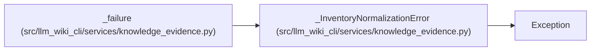

# _InventoryNormalizationError

**Location:** `src/llm_wiki_cli/services/knowledge_evidence.py:151`
**Kind:** Class
**Bases:** `Exception`
**Module:** [knowledge_evidence](../modules/knowledge_evidence.md)

## Description

_Auto-generated from `_InventoryNormalizationError` in `src/llm_wiki_cli/services/knowledge_evidence.py`._

Carries the established unknown reason and lazy local rejection context until a
basis builder catches it. The builder summarizes the actual value safely and
binds source/extractor coordinates. Exception text remains the reason alone;
arbitrary repr and source-value dumps are not diagnostic output. A reason-only
exception has no invented record detail.

## Attributes

*No annotated attributes found.*

## Methods

| Method | Signature | Decorators | Description |
|--------|-----------|------------|-------------|
| `__init__` | `(reason: str, *, pointer = None, rule = None, expected = None, value = None, exact = True)` | — | — |
| `diagnostic` | `() -> NormalizationDiagnostic \| None` | `@property` | — |

## Relationships

<!-- Auto-generated relationship summary. Do not edit by hand. -->

### Summary

| Module | Methods | Attributes |
|---|---:|---|
| [knowledge_evidence](../modules/knowledge_evidence.md) | 2 | — |

### Structure

| Kind | Entity | Module |
|---|---|---|
| Base | `Exception` | — |

### References

| Reference | Kind | Source | Call sites |
|---|---|---|---:|
| `_failure` | call | [knowledge_evidence](../modules/knowledge_evidence.md) | 1 |
